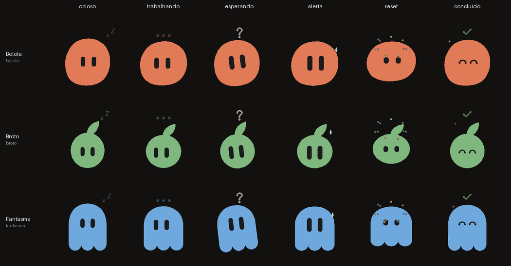
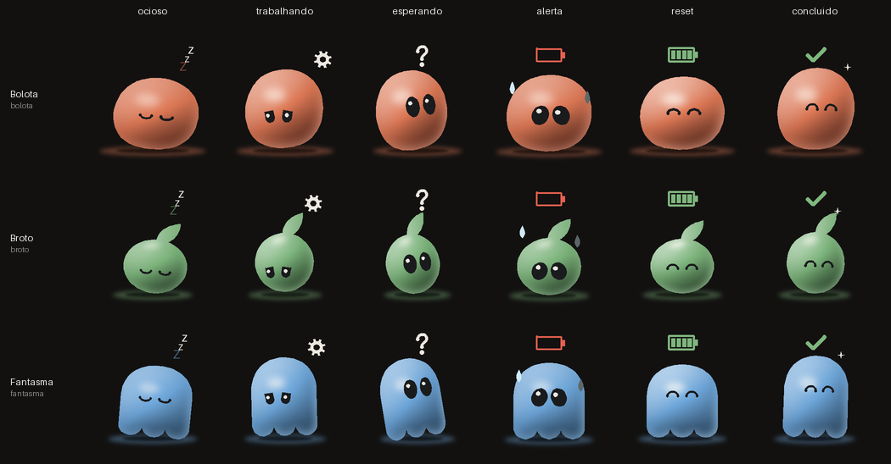

# mascotinhos

Mascotes animados em Python puro: a **forma** é um JSON (um path SVG e os olhos), a **animação** de cada estado
também é um JSON (que combina primitivas de movimento), e a biblioteca desenha com Pillow em PNG, GIF ou SVG. Um
mascote novo ou uma animação nova é um arquivo pequeno, não código.

<p align="center">
  
</p>

Nasceu do projeto [Ombro Screen](https://github.com/jvrodrigs/ombro-screen) (a telinha USB que mostra o que o Claude
Code, o Codex e o Cursor estão fazendo) e é independente dele: não importa nada de lá e serve a qualquer projeto.

- **Só Pillow.** Nada de numpy, rede ou download: roda dentro de um app assinado e notarizado.
- **Sem layout.** O tamanho, as cores e a fonte vêm de quem usa (ou dos padrões daqui).
- **Python 3.9 ou mais novo.** Pillow 10 ou mais novo.

## O que tem aqui

| Arquivo | O que é |
| --- | --- |
| `mascotinhos/formas.py` | Lê e confere as formas (contrato v1 do formato open-bot-avatar): o path vira polígonos, com a regra nonzero do SVG |
| `mascotinhos/movimento.py` | As primitivas de movimento (onda, quique, arco, rampa, mola, treme) e as curvas |
| `mascotinhos/animacao.py` | Lê, confere e compila os arquivos de animação; a `Biblioteca` de estados |
| `mascotinhos/animacoes/*.json` | Os seis estados de sempre (o pacote `classico`, o do Ombro Screen) |
| `mascotinhos/animacoes_vivo/*.json` | Os mesmos seis estados redesenhados, mais expressivos (o pacote `vivo`) |
| `mascotinhos/animacoes_3d/*.json` | Os do `vivo` com giro, câmera, luz e profundidade (o pacote `3d`) |
| `mascotinhos/extras.py` | Os extras (zZ, pontinhos, "?", gota, confete, ✓, brilhos; bateria, engrenagem, faíscas...) |
| `mascotinhos/palco.py` | As unidades do palco e o `Enquadramento` (o tamanho da camada em pixels) |
| `mascotinhos/desenho.py` | O desenho com Pillow: `quadro`, `desenhar`, `Estilo`, `Paleta` |
| `mascotinhos/svg.py` | O mesmo quadro em SVG |
| `mascotinhos/volume.py` | O 3D opcional: volume (luz e relevo), chão e sombra, giro e câmera |
| `mascotinhos/animador.py` | O `Animador`: estado, mistura entre estados, troca de forma, realce de cor |
| `mascotinhos/cli.py` | A linha de comando (`python -m mascotinhos`) |
| `mascotinhos/formas_exemplo/` | Três formas de exemplo: Bolota, Broto e Fantasma |
| `exemplos/` | Uma animação nova feita só com JSON (`dancando.json`) e a biblioteca usada no código |
| `GUIA_IA.md` | Uma página para um agente de IA criar formas e animações sem ler o código |
| `docs/emocoes.md` | Nota de design: como olhos, corpo, ritmo e extras dizem cada emoção, e as regras para 5 quadros por segundo |
| `docs/3d.md` | O 3D opcional: o que cada parâmetro faz, quanto custa, o que é aproximado no SVG e os limites |

## Instalar

```bash
pip install "mascotinhos @ git+https://github.com/GilsonB12/mascotinhos"
```

Ou copie a pasta `mascotinhos/` para o seu projeto: ela não depende de nada além do Pillow.

## A API em poucas linhas

```python
import mascotinhos as oa

formas = oa.carregar_pasta("minhas_formas/")            # {id: Definicao}; sem pasta: as de exemplo
img = oa.quadro(formas["bolota"], "esperando", 0.4, "#E07A57")   # RGBA, 312x340 (156x170 em 2x)
svg = oa.quadro_svg(formas["bolota"], "esperando", 0.4)          # o mesmo quadro em SVG

bib = oa.Biblioteca.carregar("minhas_animacoes/")       # os estados daqui + os seus (o seu vence no mesmo nome)
vivo = oa.Biblioteca.carregar(pacote="vivo")            # os seis estados no pacote "vivo" (oa.pacotes() lista)
volume = oa.Estilo(volume=oa.Volume())                  # com luz, relevo, chão e sombra (em qualquer pacote)
img3d = oa.quadro(formas["bolota"], "reset", 0.6, estilo=volume, biblioteca=oa.Biblioteca.carregar(pacote="3d"))
a = oa.Animador(forma=oa.forma_de(formas["bolota"]), cor_base=(224, 122, 87), biblioteca=bib)
a.ir_para("trabalhando", agora)                          # o estado mistura com o anterior por 0,5 s
a.usar(formas["fantasma"], (111, 168, 220), agora)      # troca de forma: encolhe, pisca, troca no meio
camada = a.camada(agora)                                 # o quadro de agora
```

O tamanho e o estilo: `oa.Estilo(enquadramento=oa.Enquadramento(largura, altura, altura_util, s), paleta=oa.Paleta(...),
fonte=minha_fonte)`. A camada sai em `s` vezes (supersampling): reduza com `Image.LANCZOS` ao compor a tela, como o
Ombro faz. `fonte(tam)` recebe o tamanho em pixels da tela e devolve a fonte já em `s` vezes; sem ela, vale a do Pillow.

Mais baixo nível: `forma_de(definicao)` põe a forma no palco; `desenhar(forma, p, animacao, t, cor, alpha_extras,
estilo)` e `desenhar_svg(...)` desenham uma pose `p` qualquer (os campos abaixo); `Animacao.parametros(t)` dá a pose
de um estado no instante `t`.

## Formas

O contrato v1 do formato do [open-bot-avatar](https://github.com/DominikScholz/open-bot-avatar): só geometria.

```json
{
  "version": 1,
  "id": "bolota",
  "name": "Bolota",
  "body": {"path": "M48 14C66 12 84 24 86 44C88 62 80 82 60 86C46 89 26 88 18 74C10 60 12 42 20 30C27 19 36 15 48 14Z"},
  "eyes": {"x": 51, "y": 50, "spacing": 18, "scale": 1.2}
}
```

- O arquivo se chama `<id>.json`; o `id` é minúsculo, com números e hífens.
- O path vai numa caixa 0..100 (de preferência dentro de 8..92) e aceita `M L H V C S Q T A Z`, absolutos e relativos.
  Vários subpaths seguem a regra nonzero: no mesmo sentido somam (a folha do Broto), no sentido contrário furam.
- Os olhos são duas pílulas de 4x11 unidades vezes `scale`, a `spacing` uma da outra, centradas em `x, y`. Crescem até
  1,45x onde o corpo deixa, com folga de 3 unidades até o contorno.
- A forma é ampliada para caber no palco com a base embaixo e centrada: o tamanho dentro da caixa não importa, a
  proporção sim.

`validar` recusa o que quebra o contrato ou deixa os olhos sem folga, e avisa quando os olhos não podem crescer até
1,45x ou o contorno encosta na borda.

## Animações

Um arquivo por estado, `<estado>.json`. O mascote tem dez **campos**, que começam neutros a cada quadro:

| Campo | Neutro | O que mexe |
| --- | --- | --- |
| `dx`, `dy` | 0 | desloca o corpo (unidades do palco; `dy` negativo sobe) |
| `sx`, `sy` | 1 | estica ou achata o corpo, em torno da base |
| `rot` | 0 | inclina o corpo em torno da base (graus) |
| `kL`, `kW` | 1 | o comprimento e a largura dos olhos |
| `olhaX`, `olhaY` | 0 | para onde os olhos olham |
| `pisca` | 0 | 1 = olhos fechados |

A forma ocupa cerca de 440 x 350 unidades do palco: um pulo de `dy: -26` é pequeno, um de `-60` é grande.

```json
{
  "formato": "mascotinhos/animacao", "versao": 1,
  "estado": "esperando", "ordem": 3, "descricao": "...",
  "olhos": "pilulas",
  "campos": {"rot": {"onda": {"periodo": 2.2, "amp": 2, "base": -6}}, "kL": 1.15},
  "trilhas": [
    {"nome": "pulinho", "ciclo": 1.9, "fases": [
      {"de": 0, "dur": 0.14, "nota": "agacha", "sy": {"rampa": {"base": 1, "amp": -0.1}}},
      {"de": 0.14, "dur": 0.44, "nota": "no ar", "dy": {"arco": {"amp": -26}}},
      {"de": 0.58, "nota": "pousa", "sy": {"mola": {"amortece": 9, "rad": 30, "amp": 0.03, "base": 1}}}
    ]}
  ],
  "extras": [{"tipo": "interrogacao", "periodo": 1.9}]
}
```

- **`campos`** valem o tempo todo. Cada **trilha**, na ordem, sobrescreve os campos que a fase da vez define.
- Uma trilha com **`ciclo`** se repete a cada `ciclo` segundos; sem ele, roda uma vez e a última fase fica.
- Uma **fase** vale do seu `de` até o `de` da próxima; a última, até `de + dur` (ou até o fim do ciclo, sem `dur`).
  `dur` é a duração da fase: o progresso `q` vai de 0 a 1 nela. `nota` é um comentário.
- **`olhos`**: `"pilulas"` (o normal), `"felizes"` (em arco, ^ ^), `"fechados"` (pálpebra fechada, ‿ ‿), `"redondos"`
  (arregalados, com um brilho) ou `"semicerrados"` (a pálpebra de cima abaixada). Um de cada:
  `{"esq": "fechados", "dir": "pilulas"}`. Uma fase também pode ter `"olhos"`: vale enquanto ela vale.
- **`ordem`** põe o estado nas listas e na folha.
- Um campo opcional, **`olhoAng`**: inclina os olhos, espelhado (graus). Positivo junta os topos dos olhos
  (preocupado, aflito); negativo afasta (bravo, decidido).
- Os campos opcionais do 3D: **`giroY`**, **`giroX`** (o corpo virado), **`zoom`**, **`incl`** (a câmera), **`luzAng`**,
  **`luz`** (a luz do volume). Estão em `docs/3d.md`.

Um valor é um número ou uma **primitiva**. `x` escolhe a variável: `t` (segundos desde que o estado começou), `c` (o
tempo dentro do ciclo), `s` (segundos desde o começo da fase) ou `q` (o progresso da fase, 0..1).

| Primitiva | Conta | Parâmetros (padrão) | `x` padrão |
| --- | --- | --- | --- |
| `onda` | `base + amp·sen(2π·x/periodo + 2π·fase)` | `periodo`, `amp` (1), `base` (0), `fase` em voltas (0) | `t` |
| `quique` | quique no chão, começando no alto: a altura `amp·abs(cos(2π·x/periodo))` ou, com `"medida": "amasso"`, `amp·(1 - abs(cos))²` | `periodo`, `amp`, `base`, `medida` | `t` |
| `arco` | meia senoide: `base + amp·sen(π·x)` | `amp`, `base` | `q` |
| `rampa` | `de → para` ou `base + amp·curva(x·escala)`; com `passos`, em degraus | `de`+`para` ou `base`+`amp`; `curva` (`suave`, `linear`, `entra`, `sai`); `escala`; `passos` | `q` |
| `mola` | balanço que some: `base + amp·e^(-x·amortece)·sen(x·rad)` (ou `2π·x·voltas`) | `amortece`, `rad` ou `voltas`, `amp`, `base` | `s` |
| `treme` | `±amp`, trocando de lado `freq` vezes por segundo | `freq`, `amp` | `t` |
| `soma`, `produto` | combinam uma lista de valores, da esquerda para a direita | | |

Os **extras** (`"extras": [{"tipo": ..., parâmetros}]`), desenhados em volta do contorno, na ordem da lista:

| Tipo | O que é | Parâmetros (padrão) |
| --- | --- | --- |
| `zz` | z e Z subindo e sumindo | `periodo` (2,6) |
| `pontinhos` | três pontos em onda acima da forma | `periodo` (1,2), `defasagem` (1,1) |
| `interrogacao` | um "?" que pulsa; acompanha o pulo do corpo | `periodo` (1,9), `segue_pulo` (true) |
| `gota` | gota de suor escorrendo | `periodo` (1,1) |
| `confete` | doze confetes, uma vez por ciclo | `ciclo` (2,6), `de` (0,5), `ate` (2,4) |
| `check` | um ✓ verde que cresce e flutua | `cresce` (0,6), `periodo` (2,6), `segue_pulo` (true) |
| `brilhos` | dois brilhinhos alternados | `periodo` (3) |
| `zzz` | uma fila de z de tamanhos variados (z z Z z) que sobe de lado e some | `n` (4), `periodo` (4,6), `sobe` (140), `deriva` (64) |
| `linhas` | linhas de texto que se escrevem uma a uma | `n` (3), `ciclo` (2,6), `largura` (46), `cor` |
| `engrenagem` | uma engrenagem girando | `periodo` (4), `cor` |
| `sinal` | um "?" ou "!" que salta a cada ciclo | `simbolo`, `ciclo` (1,6), `pulo` (14), `cor`, `segue_pulo` |
| `gotas` | gotas de suor alternadas dos dois lados | `n` (2), `periodo` (1), `cai` (70) |
| `bateria` | `"modo": "enchendo"` (barras verdes entre `de` e `ate`, depois um salto) ou `"baixa"` (vermelha, piscando) | `modo`, `ciclo` (3,2), `de` (0,2), `ate` (1,4), `periodo` (0,8), `segue_pulo` |
| `faiscas` | estrelinhas que saem em leque e somem (uma vez; ou a cada `ciclo`) | `n` (6), `ciclo` (0), `de` (0), `dur` (0,7), `partida` (16), `raio` (90), `abertura` (360), `cor` |
| `visto` | um ✓ que se desenha, dá um saltinho e flutua | `desenha` (0,45), `atraso` (0,25), `periodo` (2,6), `cor`, `segue_pulo` |

Os da segunda leva (de `zzz` em diante) também dizem onde ficam: `ancora` (`topo`, `topo-dir`, `topo-esq`, `dir`,
`esq`, `centro`, `base`: um ponto do contorno da forma), `dx` e `dy` (o deslocamento, em unidades do palco; `dy`
negativo sobe), `tamanho` (1 = o normal) e `prof` (a profundidade, para o 3D: > 0 flutua na frente do corpo, < 0
atrás). `cor`: `corpo`, `texto`, `verde`, `ambar`, `azul`, `gota` ou `vermelho`.

### Os pacotes: `classico`, `vivo` e `3d`

<p align="center">
  
</p>

Os seis estados existem em dois pacotes. O **`classico`** (`animacoes/`) é o movimento do Ombro Screen de sempre, e
é o padrão. O **`vivo`** (`animacoes_vivo/`) redesenha os mesmos seis, cada um dizendo o que é pelos olhos, pelo corpo
e por um extra (as razões estão em `docs/emocoes.md`):

| Estado | No pacote `vivo` |
| --- | --- |
| `ocioso` | dormindo: olhos fechados, afundado, respirando, z z Z z; de vez em quando estremece e espia com um olho |
| `trabalhando` | concentrado: pálpebras baixas lendo linha por linha, quique regular, linhas se escrevendo e engrenagem |
| `esperando` | chamando: pula, encara de olhos grandes com a cabeça de lado, olha para o lado, bate o pé; o "?" salta |
| `alerta` | aflito: encolhido e tremendo, olhos arregalados e caídos, bateria vermelha piscando, suor |
| `reset` | energia de volta: a bateria enche barra por barra, solta faíscas e ele dá um pulo feliz (cabe em 3 s) |
| `concluido` | orgulhoso: agacha, pulão com o ✓ se desenhando e estrelas, pousa e fica num balanço satisfeito |

`oa.Biblioteca.carregar(pacote="vivo")` no código, `--pacote vivo` na linha de comando. Um pacote novo é uma pasta
`mascotinhos/animacoes_<nome>/`.

O **`3d`** (`animacoes_3d/`) são os estados do `vivo` com o 3D opcional: dormindo com a luz respirando, lendo com a
cabeça acompanhando a linha, virando o corpo para olhar para o lado, uma volta inteira enquanto a bateria enche, o
pulo com a sombra encolhendo no chão e a câmera chegando perto.

## 3D opcional

<p align="center">
  
</p>

Qualquer forma ganha **volume** (um relevo macio tirado da silhueta, com luz, brilho e a parte de baixo mais escura),
**chão e sombra** (que reagem ao pulo), **giro** (`giroY`, `giroX`: a silhueta estreita e os olhos escorregam pela
superfície; de 0 a 360, uma volta inteira) e **câmera** (`zoom`, `incl`; extras com `prof` flutuando na frente ou
atrás). Sem modelagem e sem dependência nova: é 2,5D, feito só com Pillow, a 3 a 5 ms por quadro.

```python
estilo = oa.Estilo(volume=oa.Volume(luz_x=-0.55, luz_y=-0.8))     # None (o padrão) = chapado, como sempre
oa.quadro(formas["broto"], "esperando", 2.6, estilo=estilo, biblioteca=oa.Biblioteca.carregar(pacote="3d"))
```

O volume vale para qualquer pacote (`--volume`); o pacote `3d` usa os campos de giro e de câmera. Desligado, o desenho
é o mesmo de antes, pixel a pixel. No SVG o volume vira gradientes. Parâmetros, custo e limites: `docs/3d.md`.

Os erros dizem onde está o problema, em português: `trilhas[0].fases[1].sy.soma[0].rampa: "de" e "para" andam
juntos`. `validar` também percorre 12 s do estado e avisa se algum campo passa do confortável (a forma sai do quadro,
os olhos saem do rosto).

## Exemplo completo: um mascote novo e uma animação nova

**A forma.** Crie `minhas_formas/pera.json` (desenhe à mão, ou num editor de SVG numa prancheta de 100x100) e confira:

```json
{"version": 1, "id": "pera", "name": "Pera",
 "body": {"path": "M50 14C60 14 64 24 64 34C64 42 82 50 82 66C82 80 68 88 50 88C32 88 18 80 18 66C18 50 36 42 36 34C36 24 40 14 50 14Z"},
 "eyes": {"x": 50, "y": 64, "spacing": 18, "scale": 1.2}}
```

```bash
python -m mascotinhos validar minhas_formas/pera.json
python -m mascotinhos folha --formas minhas_formas -o saida/folha.png     # olhe a pera em todos os estados
```

**A animação.** `exemplos/animacoes/dancando.json` é um estado novo feito só com JSON: balança de um lado para o outro
(`onda` em `rot` e `dx`), dá um passinho a cada 0,6 s (uma trilha com agacha, sobe com `arco` e assenta com `mola`) e
mostra `brilhos`.

```bash
python -m mascotinhos validar exemplos/animacoes/dancando.json
python -m mascotinhos tira pera exemplos/animacoes/dancando.json --formas minhas_formas --segundos 1.2 -o saida/danca.png
python -m mascotinhos gif pera dancando --formas minhas_formas --animacoes exemplos/animacoes -o saida/danca.gif
```

No código, a pasta entra na biblioteca: `oa.Biblioteca.carregar("exemplos/animacoes")` (ver `exemplos/no_codigo.py`).

## Linha de comando

```
python -m mascotinhos listar                              as formas e os estados disponíveis
python -m mascotinhos folha [--t 1.2] [--escala 1]        PNG com todas as formas em todos os estados
python -m mascotinhos tira <forma> <estado>               PNG com quadros seguidos (--segundos 2 --quadros 10)
python -m mascotinhos gif <forma> <estado>                GIF (--segundos 4 --fps 20 --escala 2)
python -m mascotinhos svg <forma> <estado> --t 0.4        o quadro de um instante em SVG
python -m mascotinhos validar <arquivo.json> [...]        confere formas e animações
```

`<forma>` é um id da pasta `--formas` (sem ela, as de exemplo) ou o caminho de um `.json`; `<estado>`, um estado da
biblioteca, de `--animacoes`, ou o caminho de um `.json`. Também: `--pacote vivo` ou `--pacote 3d` (este já liga o
volume; `--chapado` desliga), `--volume` (luz, relevo, chão e sombra em qualquer pacote), `--cor #RRGGBB` (sem ela, cada
forma da pasta tem a sua cor), `--fundo #RRGGBB`, `--fonte arquivo.ttf`, `-o arquivo`. Para ver como uma tela de 5
quadros por segundo mostra: `gif ... --fps 5 --escala 1`. Os arquivos saem na pasta atual (ou em `-o`), nunca dentro da biblioteca. Instalado com
pip, o comando também se chama `mascotinhos`.

## Testes

```bash
python -m unittest discover -s tests
```

`tests/test_referencia.py` guarda o movimento dos seis estados (os mesmos números do mascote do Ombro antes de virar
biblioteca, em qualquer máquina) e os pixels das formas de exemplo (só na plataforma e nas versões de Pillow e FreeType
em que foram gerados; em outras, é pulado). Mudou o desenho de propósito? `python tests/test_referencia.py --gerar`.

## O que vem depois

- **Fase 2, o player do app:** o mesmo JSON tocado em TypeScript (as seis primitivas, as fases e os extras são poucas
  linhas cada), conferido contra `svg.py` com os mesmos instantes de `tests/test_referencia.py`.
- **Fase 3, formas geradas:** um gerador paramétrico de formas originais (contorno por harmônicos, cantos e simetria
  como parâmetros), que já sai validado por `validar_definicao`.

## Licença

MIT (ver `LICENSE`). O formato das formas é o contrato v1 do open-bot-avatar (MIT, © Dominik Scholz); nenhum código de
lá está aqui. As três formas de exemplo foram desenhadas para esta biblioteca.
