# mascotinhos

Mascotes animados que mostram um estado (dormindo, trabalhando, esperando você, alerta, recarregado, concluído).
Você escolhe o **mascote**, o **estado** e o **visual**; a biblioteca desenha em PNG, GIF ou SVG com Python (só Pillow)
e, no navegador, com o player em `js/`. Tudo é dado: um mascote ou uma animação nova é um arquivo JSON pequeno.

Nasceu do projeto [Ombro Screen](https://github.com/jvrodrigs/ombro-screen) e é independente dele.

## Escolha o visual

Cada quadro abaixo mostra **o resultado** e **como ligar** nos três lugares: a linha de comando (`terminal`), o
código (`Python`) e a página (`navegador`). Para os exemplos em Python e no navegador, comece assim:

```python
import mascotinhos as oa
forma = oa.exemplos()["bolota"]          # um dos doze mascotes que vêm junto
```

```js
import { montar } from "mascotinhos";    // a pasta js/ deste repositório
const el = document.querySelector("#mascote");
```

### 1. O pacote de animações

O pacote decide **como o mascote se mexe** em cada estado. São quatro, com os mesmos seis estados. Aqui, todos no
estado `reset` (o limite de uso foi renovado).

<table>
<tr><td width="170">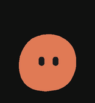</td><td>

**`classico`** (o padrão). O movimento original do Ombro Screen: simples e discreto.

```text
terminal   python -m mascotinhos gif bolota reset -o classico.gif
Python     oa.quadro(forma, "reset", 1.0)
navegador  montar(el, { forma: "bolota", estado: "reset" })
```

</td></tr>
<tr><td>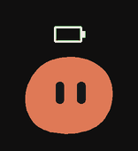</td><td>

**`vivo`**. Mais expressivo: cada estado se explica sozinho (dormindo com z z Z, bateria enchendo, ✓ se desenhando).

```text
terminal   python -m mascotinhos gif bolota reset --pacote vivo -o vivo.gif
Python     oa.quadro(forma, "reset", 1.0, biblioteca=oa.Biblioteca.carregar(pacote="vivo"))
navegador  montar(el, { forma: "bolota", estado: "reset", pacote: "vivo" })
```

</td></tr>
<tr><td>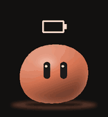</td><td>

**`3d`**. O `vivo` com giro, câmera e luz: o mascote vira o corpo, dá uma volta, a câmera chega perto. Já vem com o
volume ligado.

```text
terminal   python -m mascotinhos gif bolota reset --pacote 3d -o 3d.gif
Python     oa.quadro(forma, "reset", 1.0, estilo=oa.Estilo(volume=oa.Volume()), biblioteca=oa.Biblioteca.carregar(pacote="3d"))
navegador  montar(el, { forma: "bolota", estado: "reset", pacote: "3d" })
```

</td></tr>
<tr><td>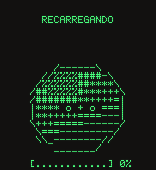</td><td>

**`terminal`**. O `vivo` na linguagem de um terminal: prompt sendo digitado, barra de progresso, `[ OK ]`. Já vem no
estilo terminal.

```text
terminal   python -m mascotinhos gif bolota reset --pacote terminal -o terminal.gif
Python     oa.quadro(forma, "reset", 1.0, estilo=oa.Estilo(terminal=oa.Terminal()), biblioteca=oa.Biblioteca.carregar(pacote="terminal"))
navegador  montar(el, { forma: "bolota", estado: "reset", pacote: "terminal" })
```

</td></tr>
</table>

### 2. Chapado ou com volume

O volume é **como o corpo é pintado**, e vale em qualquer pacote.

<table>
<tr><td width="170">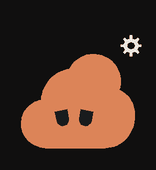</td><td>

**Chapado** (o padrão). Cor lisa, como um adesivo.

```text
terminal   python -m mascotinhos gif ombro-cloud trabalhando --pacote vivo -o chapado.gif
Python     oa.quadro(oa.exemplos()["ombro-cloud"], "trabalhando", 1.0, biblioteca=oa.Biblioteca.carregar(pacote="vivo"))
navegador  montar(el, { forma: "ombro-cloud", estado: "trabalhando", pacote: "vivo", volume: false })
```

</td></tr>
<tr><td>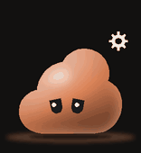</td><td>

**Com volume**. Luz, relevo, um brilho, o chão e a sombra: o corpo parece inflado.

```text
terminal   python -m mascotinhos gif ombro-cloud trabalhando --pacote vivo --volume -o volume.gif
Python     oa.quadro(oa.exemplos()["ombro-cloud"], "trabalhando", 1.0, estilo=oa.Estilo(volume=oa.Volume()), biblioteca=oa.Biblioteca.carregar(pacote="vivo"))
navegador  montar(el, { forma: "ombro-cloud", estado: "trabalhando", pacote: "vivo", volume: true })
```

</td></tr>
</table>

No pacote `3d` o volume já vem ligado; para desligar: `--chapado` no terminal, `volume: false` no navegador, e no
Python é só não passar o `estilo`.

### 3. O estilo terminal

Desenha **tudo em letras**, numa grade de 26 por 21 caracteres. Vale em qualquer pacote (o pacote `terminal` já vem
com ele).

<table>
<tr><td width="170"></td><td>

**Estilo terminal num pacote qualquer** (aqui, o `vivo`): os desenhos em volta viram letras também.

```text
terminal   python -m mascotinhos gif ombro-cloud trabalhando --pacote vivo --estilo terminal -o letras.gif
Python     oa.quadro(oa.exemplos()["ombro-cloud"], "trabalhando", 1.0, estilo=oa.Estilo(terminal=oa.Terminal()), biblioteca=oa.Biblioteca.carregar(pacote="vivo"))
navegador  montar(el, { forma: "ombro-cloud", estado: "trabalhando", pacote: "vivo", estilo: "terminal" })
```

</td></tr>
</table>

#### A tinta: com o que o corpo é escrito

<table>
<tr><td width="170">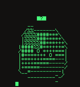</td><td>

**`ascii`** (o padrão). Letras mais cheias onde bate luz, mais ralas na sombra: `.:-=+*#%@`.

```text
terminal   python -m mascotinhos gif cubo esperando --pacote terminal --tinta ascii -o ascii.gif
Python     oa.Estilo(terminal=oa.Terminal(tinta="ascii"))
navegador  montar(el, { forma: "cubo", estado: "esperando", pacote: "terminal", tinta: "ascii" })
```

</td></tr>
<tr><td>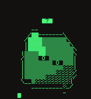</td><td>

**`blocos`**. Quadradinhos cheios e pontilhados (`░▒▓█`): parece pixel art.

```text
terminal   python -m mascotinhos gif cubo esperando --pacote terminal --tinta blocos -o blocos.gif
Python     oa.Estilo(terminal=oa.Terminal(tinta="blocos"))
navegador  montar(el, { forma: "cubo", estado: "esperando", pacote: "terminal", tinta: "blocos" })
```

</td></tr>
<tr><td>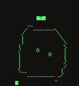</td><td>

**`contorno`**. Só a borda, com `/ \ | - _`.

```text
terminal   python -m mascotinhos gif cubo esperando --pacote terminal --tinta contorno -o contorno.gif
Python     oa.Estilo(terminal=oa.Terminal(tinta="contorno"))
navegador  montar(el, { forma: "cubo", estado: "esperando", pacote: "terminal", tinta: "contorno" })
```

</td></tr>
</table>

#### A borda desenhada (`borda`)

Nas tintas `ascii` e `blocos`, a beirada do corpo leva os traços do contorno, para a silhueta ficar clara. Vem ligada.

<table>
<tr><td width="170">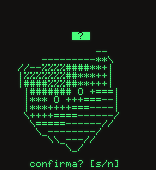<br>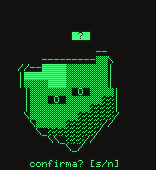</td><td>

**Com borda** (o padrão), em `ascii` e em `blocos`.

```text
terminal   (já vem ligada; não há opção na linha de comando)
Python     oa.Estilo(terminal=oa.Terminal(tinta="ascii", borda=True))
navegador  montar(el, { forma: "chevron", estado: "esperando", pacote: "terminal", borda: true })
```

</td></tr>
<tr><td><br>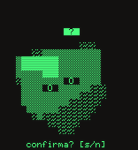</td><td>

**Sem borda**: só as letras da luz; a beirada fica mais macia e menos definida.

```text
terminal   (só pelo código)
Python     oa.Estilo(terminal=oa.Terminal(tinta="ascii", borda=False))
navegador  montar(el, { forma: "chevron", estado: "esperando", pacote: "terminal", borda: false })
```

</td></tr>
</table>

#### O fósforo: a cor das letras

<table>
<tr><td width="170">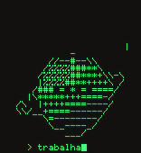</td><td>

**`verde`** (o padrão).

```text
terminal   python -m mascotinhos gif orbita trabalhando --pacote terminal --fosforo verde -o verde.gif
Python     oa.Estilo(terminal=oa.Terminal(fosforo="verde"))
navegador  montar(el, { forma: "orbita", estado: "trabalhando", pacote: "terminal", fosforo: "verde" })
```

</td></tr>
<tr><td></td><td>

**`ambar`**.

```text
terminal   python -m mascotinhos gif orbita trabalhando --pacote terminal --fosforo ambar -o ambar.gif
Python     oa.Estilo(terminal=oa.Terminal(fosforo="ambar"))
navegador  montar(el, { forma: "orbita", estado: "trabalhando", pacote: "terminal", fosforo: "ambar" })
```

</td></tr>
<tr><td>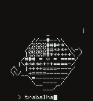</td><td>

**`branco`**.

```text
terminal   python -m mascotinhos gif orbita trabalhando --pacote terminal --fosforo branco -o branco.gif
Python     oa.Estilo(terminal=oa.Terminal(fosforo="branco"))
navegador  montar(el, { forma: "orbita", estado: "trabalhando", pacote: "terminal", fosforo: "branco" })
```

</td></tr>
<tr><td></td><td>

**`mascote`**: as letras na cor do próprio mascote.

```text
terminal   python -m mascotinhos gif orbita trabalhando --pacote terminal --fosforo mascote -o mascote.gif
Python     oa.Estilo(terminal=oa.Terminal(fosforo="mascote"))
navegador  montar(el, { forma: "orbita", estado: "trabalhando", pacote: "terminal", fosforo: "mascote" })
```

</td></tr>
<tr><td>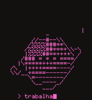</td><td>

**Uma cor sua**, em `#RRGGBB`.

```text
terminal   python -m mascotinhos gif orbita trabalhando --pacote terminal --fosforo "#FF66CC" -o rosa.gif
Python     oa.Estilo(terminal=oa.Terminal(fosforo="#FF66CC"))
navegador  montar(el, { forma: "orbita", estado: "trabalhando", pacote: "terminal", fosforo: "#FF66CC" })
```

</td></tr>
</table>

#### O acabamento de tela antiga (`varredura`, `halo`)

<table>
<tr><td width="170">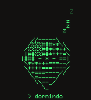</td><td>

**Ligado** (o padrão): uma linha de pontos sim, outra não, fica mais escura (`varredura`, 0,22) e as letras têm um
brilho em volta (`halo`, 0,25).

```text
terminal   (já vem ligado; não há opção na linha de comando)
Python     oa.Estilo(terminal=oa.Terminal(varredura=0.22, halo=0.25))
navegador  montar(el, { forma: "scout", pacote: "terminal", varredura: 0.22, halo: 0.25 })
```

</td></tr>
<tr><td></td><td>

**Desligado**: só os pontos, acesos ou apagados.

```text
terminal   (só pelo código)
Python     oa.Estilo(terminal=oa.Terminal(varredura=0, halo=0))
navegador  montar(el, { forma: "scout", pacote: "terminal", varredura: 0, halo: 0 })
```

</td></tr>
</table>

#### Números de verdade nos textos (`dados`)

<table>
<tr><td width="170">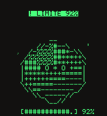</td><td>

**Sem `dados`**: vale o número do arquivo da animação (92).

```text
terminal   python -m mascotinhos gif sereno alerta --pacote terminal -o alerta.gif
Python     oa.Estilo(terminal=oa.Terminal())
navegador  montar(el, { forma: "sereno", estado: "alerta", pacote: "terminal" })
```

</td></tr>
<tr><td>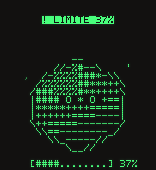</td><td>

**Com `dados`**: o seu programa passa o valor e o texto e a barra acompanham.

```text
terminal   (só pelo código)
Python     oa.Estilo(terminal=oa.Terminal(dados={"limite": 37}))
navegador  montar(el, { forma: "sereno", estado: "alerta", pacote: "terminal", dados: { limite: 37 } })
```

</td></tr>
</table>

No navegador, para trocar o valor depois: `m.ajustar({ dados: { limite: 41 } })`.

### 4. Quadros por segundo

<table>
<tr><td width="170">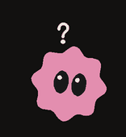</td><td>

**Liso** (20 quadros por segundo ou mais): como um app anima.

```text
terminal   python -m mascotinhos gif maestro esperando --pacote vivo --fps 20 -o liso.gif
Python     (o laço é seu: peça um quadro novo quantas vezes quiser por segundo)
navegador  montar(el, { forma: "maestro", estado: "esperando", pacote: "vivo" })
```

</td></tr>
<tr><td></td><td>

**5 quadros por segundo**: como uma telinha USB mostra. As animações foram feitas para ler bem assim.

```text
terminal   python -m mascotinhos gif maestro esperando --pacote vivo --fps 5 -o passos.gif
Python     (o laço é seu: peça um quadro a cada 0,2 s)
navegador  montar(el, { forma: "maestro", estado: "esperando", pacote: "vivo", fps: 5 })
```

</td></tr>
</table>

### 5. Os mascotes

Doze vêm junto. Para escolher, use o **id** (o nome em letras miúdas): `python -m mascotinhos gif ID esperando`,
`oa.exemplos()["ID"]` no Python, `montar(el, { forma: "ID" })` no navegador.

| | | |
| :---: | :---: | :---: |
| 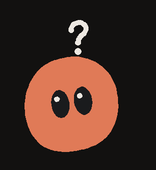<br>**Bolota** `bolota` | 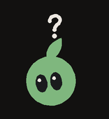<br>**Broto** `broto` | 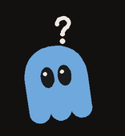<br>**Fantasma** `fantasma` |
| 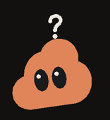<br>**Ombro Cloud** `ombro-cloud` | 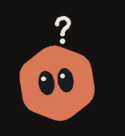<br>**Sereno** `sereno` | 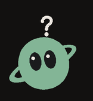<br>**Órbita** `orbita` |
| 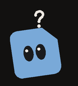<br>**Cubo** `cubo` | 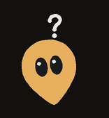<br>**Scout** `scout` | 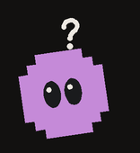<br>**Pixel** `pixel` |
| 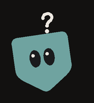<br>**Chevron** `chevron` | 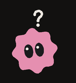<br>**Maestro** `maestro` | 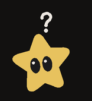<br>**Nova** `nova` |

Os nove mascotes do Ombro foram desenhados por Jonas Timbaúba e João Vitor Lima para o Ombro Screen.

<table>
<tr><td width="170">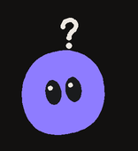</td><td>

**A cor.** Cada mascote tem a sua cor sugerida; para trocar, passe a sua em `#RRGGBB`.

```text
terminal   python -m mascotinhos gif bolota esperando --pacote vivo --cor "#8E7CFF" -o lilas.gif
Python     oa.quadro(forma, "esperando", 1.7, "#8E7CFF", biblioteca=oa.Biblioteca.carregar(pacote="vivo"))
navegador  montar(el, { forma: "bolota", estado: "esperando", pacote: "vivo", cor: "#8E7CFF" })
```

</td></tr>
</table>

**Um mascote seu** é um arquivo JSON com o contorno e os olhos (ver [Formas](#formas)): `--formas minha_pasta` no
terminal, `oa.carregar_pasta("minha_pasta")` no Python, e no navegador o próprio JSON em `forma`. Não quer desenhar o
contorno? Veja [Crie o seu mascote](#crie-o-seu-mascote). Sem `cor`, cada mascote que vem junto usa a sua cor sugerida,
também no navegador; um JSON seu, sem cor, sai na laranja padrão.

### O que combina com o quê

| Você quer | Use | Observação |
| --- | --- | --- |
| Qualquer pacote com luz e sombra | pacote + **volume** | `classico`, `vivo` e `3d` aceitam; o `3d` já vem ligado |
| Qualquer pacote em letras | pacote + **estilo terminal** | os desenhos em volta viram letras; o giro do `3d` continua valendo |
| Terminal com prompt e barra | pacote **`terminal`** | já vem no estilo terminal; escolha a tinta e o fósforo |
| Pacote `terminal` sem letras | `--estilo chapado` | os textos saem com uma fonte comum |
| Volume **e** terminal juntos | não combinam | no estilo terminal, a luz vira letras mais cheias e mais ralas |
| Tinta, fósforo, borda, varredura, halo, `dados` | só no **estilo terminal** | fora dele, não têm efeito |
| Qualquer mascote, qualquer cor, qualquer velocidade | sempre | valem em todos os visuais |

### Receitas prontas

Copie, cole e rode na pasta do repositório. Cada comando grava o arquivo do `-o`.

<table>
<tr><td width="170">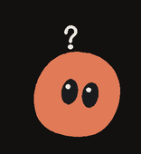</td><td>

```bash
python -m mascotinhos gif bolota esperando --pacote vivo --escala 1 --segundos 3 --fps 12 -o receita-1.gif
```

</td></tr>
<tr><td>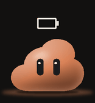</td><td>

```bash
python -m mascotinhos gif ombro-cloud reset --pacote 3d --escala 1 --segundos 3.4 --fps 8 -o receita-2.gif
```

</td></tr>
<tr><td>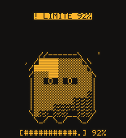</td><td>

```bash
python -m mascotinhos gif fantasma alerta --pacote terminal --tinta blocos --fosforo ambar --escala 1 --segundos 3 --fps 12 -o receita-3.gif
```

</td></tr>
<tr><td></td><td>

```bash
python -m mascotinhos gif nova concluido --pacote vivo --volume --cor "#FFD23F" --escala 1 --segundos 3 --fps 10 -o receita-4.gif
```

</td></tr>
<tr><td>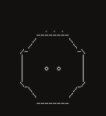</td><td>

```bash
python -m mascotinhos gif pixel trabalhando --estilo terminal --tinta contorno --fosforo branco --escala 1 --segundos 3 --fps 12 -o receita-5.gif
```

</td></tr>
</table>

Uma prancha com vários mascotes e estados de uma vez:

```bash
python -m mascotinhos folha --pacote terminal --so bolota,orbita,cubo --estados ocioso,esperando,reset --t 1 -o receita-6.png
```

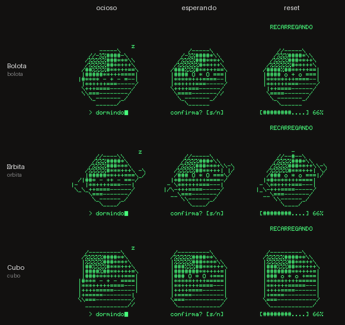

Outros comandos: `python -m mascotinhos listar` (os mascotes e os estados), `tira` (quadros lado a lado), `svg`,
`validar` (ver [Linha de comando](#linha-de-comando)). As imagens desta página são feitas por `docs/gerar_exemplos.py`.

### No Ombro Screen

Um programa que usa a biblioteca escolhe quais opções mostra para quem usa. O Ombro Screen, por exemplo, expõe quatro
chaves no `config.json` dele:

| Chave | Valores | O que liga |
| --- | --- | --- |
| `animacoes` | `classico`, `vivo`, `3d`, `terminal` | o pacote de animações |
| `mascote_estilo` | `chapado`, `volume`, `terminal` | como desenhar |
| `terminal_tinta`, `terminal_fosforo` | `ascii`, `blocos`, `contorno`; `verde`, `ambar`, `branco`, `mascote`, `#RRGGBB` | a tinta e a cor do estilo terminal |

Por dentro são duas linhas: `Biblioteca.carregar(pacote=...)` e `Estilo(volume=... | terminal=Terminal(...))`. No
alerta, ele passa o uso real em `Terminal(dados={"limite": ...})`.

## Crie o seu mascote

Não precisa desenhar. Você escreve uma **receita** pequena (a família e alguns números) e o gerador calcula a forma:
o contorno, os cantos arredondados, o tamanho certo e os olhos no lugar. O que sai é um mascote como os outros: vale em
todos os pacotes e visuais de cima.

<table>
<tr><td width="170">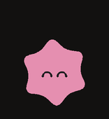</td><td>

**A receita** é um JSON de uma linha. Esta está em `exemplos/receitas/cometa.json`:

```json
{"familia": "estrela", "pontas": 6, "arredonda": 0.8, "miolo": 0.7, "semente": 7, "cor": "#E58FB0", "nome": "Cometa"}
```

```text
terminal   python -m mascotinhos gif exemplos/receitas/cometa.json concluido --pacote vivo -o cometa.gif
Python     oa.quadro(oa.ler_definicao(oa.gerar({"familia": "estrela", "pontas": 6, "cor": "#E58FB0"})), "concluido", 1.0, "#E58FB0")
navegador  montar(el, { forma: { familia: "estrela", pontas: 6, cor: "#E58FB0" }, estado: "concluido", pacote: "vivo" })
```

</td></tr>
</table>

### As dez famílias

Cada uma com os parâmetros no padrão. Para começar: `python -m mascotinhos gerar FAMILIA -o meu.json`.

| | | |
| :---: | :---: | :---: |
| 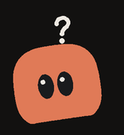<br>`bolha` | <br>`nuvem` | 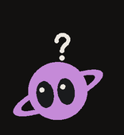<br>`planeta` |
| 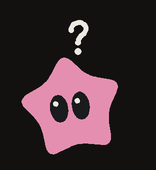<br>`estrela` | 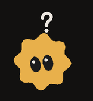<br>`engrenagem` | 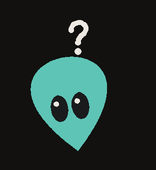<br>`gota` |
| 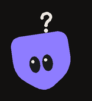<br>`escudo` | 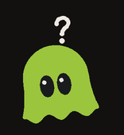<br>`fantasma` | 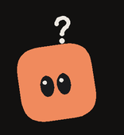<br>`bloco` |
| 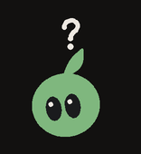<br>`broto` |  |  |

### Os parâmetros mudam a forma

Cada família tem os seus (a lista inteira, com as faixas, está em [docs/gerador.md](docs/gerador.md)). Três exemplos:

**`pontas`** da estrela: quantas pontas.

| | | |
| :---: | :---: | :---: |
| 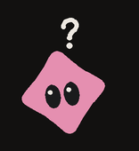<br>`--pontas 4` | <br>`--pontas 6` | 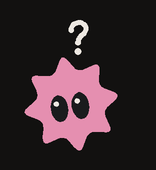<br>`--pontas 8` |

**`arredonda`**: de cantos vivos (0) a bem redondos (1).

| | | |
| :---: | :---: | :---: |
| 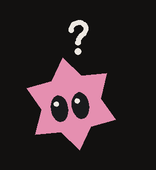<br>`--arredonda 0` | <br>`--arredonda 0.5` | <br>`--arredonda 1` |

**`enfeite`**: orelhas, antena ou rabo por cima de qualquer família.

| | | |
| :---: | :---: | :---: |
| <br>`--enfeite orelhas` | <br>`--enfeite antena` | <br>`--enfeite rabo` |

Algumas famílias têm variações de estilo:

| | | |
| :---: | :---: | :---: |
| <br>`gerar engrenagem --dente reto` | <br>`gerar bloco --estilo degrau` | <br>`gerar gota --ponta cima` |

### A semente: a mesma receita, sempre o mesmo mascote

A `semente` é um número inteiro que decide os detalhes sorteados (o tamanho de cada gomo da nuvem, as ondas da bolha,
o lado da folha). Trocou a semente, mudou o mascote; repetiu a semente, ele volta **igual**, no Python e no navegador.

| | | |
| :---: | :---: | :---: |
| <br>`gerar nuvem --gomos 4 --semente 1` | <br>`--semente 2` | <br>`--semente 3` |

### Sorteie vários

Sem ideia? Peça uma pasta de mascotes sorteados (cada dezena passa pelas dez famílias) e veja todos numa prancha:

```bash
python -m mascotinhos gerar --aleatorio 12 --semente 21 --pasta saida/sorteados
python -m mascotinhos folha --formas saida/sorteados --pacote vivo -o saida/sorteados.png
```

Os três primeiros dessa semente, e dois deles nos outros visuais:

| | | |
| :---: | :---: | :---: |
| <br>o primeiro | <br>o segundo | <br>o terceiro |
| <br>o primeiro, `--pacote 3d` | <br>o segundo, `--pacote terminal` | |

### Onde usar a receita

| Onde | Como |
| --- | --- |
| **Terminal** | `gerar FAMILIA --parametro V -o meu.json` grava a forma pronta; `gif`, `tira`, `svg` e `folha` aceitam o arquivo da receita no lugar da forma (`folha receita1.json receita2.json`); `validar receita.json` confere |
| **Python** | `oa.gerar(receita)` devolve a forma (o JSON do contrato v1); `oa.receita_aleatoria(semente)` e `oa.aleatorios(12)` sorteiam; `oa.cor_da_receita(receita)` dá a cor |
| **Navegador** | a receita vai direto em `forma`; `gerar`, `receitaAleatoria` e `aleatorios` são os mesmos; a demonstração (`js/demo/`) tem o painel **Criar mascote**, com controles e o botão de copiar o JSON |

A receita aceita ainda `id`, `nome` e, se você quiser decidir, `olhos` (`x`, `y`, `spacing`, `scale`); sem `olhos`,
eles vão sozinhos para o maior espaço livre do rosto. Toda forma que sai passa pela mesma conferência das feitas à mão
(`validar_definicao`, sem erro e sem aviso); uma receita impossível dá um erro que diz o que mudar.

## Por dentro

- **Só Pillow.** Nada de numpy, rede ou download: roda dentro de um app assinado e notarizado.
- **Sem layout.** O tamanho, as cores e a fonte vêm de quem usa (ou dos padrões daqui).
- **Python 3.9 ou mais novo.** Pillow 10 ou mais novo.

</content>
## O que tem aqui

| Arquivo | O que é |
| --- | --- |
| `mascotinhos/formas.py` | Lê e confere as formas (contrato v1 do formato open-bot-avatar): o path vira polígonos, com a regra nonzero do SVG |
| `mascotinhos/movimento.py` | As primitivas de movimento (onda, quique, arco, rampa, mola, treme) e as curvas |
| `mascotinhos/animacao.py` | Lê, confere e compila os arquivos de animação; a `Biblioteca` de estados |
| `mascotinhos/animacoes/*.json` | Os seis estados de sempre (o pacote `classico`, o do Ombro Screen) |
| `mascotinhos/animacoes_vivo/*.json` | Os mesmos seis estados redesenhados, mais expressivos (o pacote `vivo`) |
| `mascotinhos/animacoes_3d/*.json` | Os do `vivo` com giro, câmera, luz e profundidade (o pacote `3d`) |
| `mascotinhos/animacoes_terminal/*.json` | Os do `vivo` na linguagem do terminal: prompt, barra de progresso, `[ OK ]` (o pacote `terminal`) |
| `mascotinhos/extras.py` | Os extras (zZ, pontinhos, "?", gota, confete, ✓, brilhos; bateria, engrenagem, faíscas...) |
| `mascotinhos/palco.py` | As unidades do palco e o `Enquadramento` (o tamanho da camada em pixels) |
| `mascotinhos/desenho.py` | O desenho com Pillow: `quadro`, `desenhar`, `Estilo`, `Paleta` |
| `mascotinhos/svg.py` | O mesmo quadro em SVG |
| `mascotinhos/volume.py` | O 3D opcional: volume (luz e relevo), chão e sombra, giro e câmera |
| `mascotinhos/terminal.py` | O estilo terminal: o quadro em células de caracteres (ascii, blocos ou contorno), com fósforo, varredura e halo |
| `mascotinhos/fonte_bitmap.py` | A fonte de pontos do terminal (6x8), desenhada para a biblioteca |
| `mascotinhos/animador.py` | O `Animador`: estado, mistura entre estados, troca de forma, realce de cor |
| `mascotinhos/gerador.py` | O gerador: dez famílias de formas com parâmetros, enfeites, semente e olhos postos sozinhos; da receita à forma conferida |
| `mascotinhos/cli.py` | A linha de comando (`python -m mascotinhos`) |
| `mascotinhos/formas_exemplo/` | Os doze mascotes que vêm junto (Bolota, Broto, Fantasma e os nove do Ombro Screen) e o `_cores.json` com a cor sugerida de cada um |
| `exemplos/` | Uma animação nova feita só com JSON (`dancando.json`), uma receita do gerador (`receitas/cometa.json`) e a biblioteca usada no código |
| `GUIA_IA.md` | Uma página para um agente de IA criar formas e animações sem ler o código |
| `docs/emocoes.md` | Nota de design: como olhos, corpo, ritmo e extras dizem cada emoção, e as regras para 5 quadros por segundo |
| `docs/3d.md` | O 3D opcional: o que cada parâmetro faz, quanto custa, o que é aproximado no SVG e os limites |
| `docs/gerador.md` | O gerador de mascotes: cada família e cada parâmetro, os enfeites, a semente, os olhos e a API |
| `docs/terminal.md` | O estilo terminal: a grade, as tintas, os extras de texto, os valores de quem desenha e o que é aproximado |

## Instalar

```bash
pip install "mascotinhos @ git+https://github.com/GilsonB12/mascotinhos"
```

Ou copie a pasta `mascotinhos/` para o seu projeto: ela não depende de nada além do Pillow.

## A API em poucas linhas

```python
import mascotinhos as oa

formas = oa.carregar_pasta("minhas_formas/")            # {id: Definicao}; sem pasta: as de exemplo
img = oa.quadro(formas["bolota"], "esperando", 0.4, "#E07A57")   # RGBA, 312x340 (156x170 em 2x)
svg = oa.quadro_svg(formas["bolota"], "esperando", 0.4)          # o mesmo quadro em SVG

bib = oa.Biblioteca.carregar("minhas_animacoes/")       # os estados daqui + os seus (o seu vence no mesmo nome)
vivo = oa.Biblioteca.carregar(pacote="vivo")            # os seis estados no pacote "vivo" (oa.pacotes() lista)
volume = oa.Estilo(volume=oa.Volume())                  # com luz, relevo, chão e sombra (em qualquer pacote)
terminal = oa.Estilo(terminal=oa.Terminal(tinta="ascii", fosforo="verde"))   # em caracteres, como um terminal
img3d = oa.quadro(formas["bolota"], "reset", 0.6, estilo=volume, biblioteca=oa.Biblioteca.carregar(pacote="3d"))
a = oa.Animador(forma=oa.forma_de(formas["bolota"]), cor_base=(224, 122, 87), biblioteca=bib)
a.ir_para("trabalhando", agora)                          # o estado mistura com o anterior por 0,5 s
a.usar(formas["fantasma"], (111, 168, 220), agora)      # troca de forma: encolhe, pisca, troca no meio
camada = a.camada(agora)                                 # o quadro de agora
```

O tamanho e o estilo: `oa.Estilo(enquadramento=oa.Enquadramento(largura, altura, altura_util, s), paleta=oa.Paleta(...),
fonte=minha_fonte)`. A camada sai em `s` vezes (supersampling): reduza com `Image.LANCZOS` ao compor a tela, como o
Ombro faz. `fonte(tam)` recebe o tamanho em pixels da tela e devolve a fonte já em `s` vezes; sem ela, vale a do Pillow.

Mais baixo nível: `forma_de(definicao)` põe a forma no palco; `desenhar(forma, p, animacao, t, cor, alpha_extras,
estilo)` e `desenhar_svg(...)` desenham uma pose `p` qualquer (os campos abaixo); `Animacao.parametros(t)` dá a pose
de um estado no instante `t`.

## Formas

O contrato v1 do formato do [open-bot-avatar](https://github.com/DominikScholz/open-bot-avatar): só geometria.

```json
{
  "version": 1,
  "id": "bolota",
  "name": "Bolota",
  "body": {"path": "M48 14C66 12 84 24 86 44C88 62 80 82 60 86C46 89 26 88 18 74C10 60 12 42 20 30C27 19 36 15 48 14Z"},
  "eyes": {"x": 51, "y": 50, "spacing": 18, "scale": 1.2}
}
```

- O arquivo se chama `<id>.json`; o `id` é minúsculo, com números e hífens.
- O path vai numa caixa 0..100 (de preferência dentro de 8..92) e aceita `M L H V C S Q T A Z`, absolutos e relativos.
  Vários subpaths seguem a regra nonzero: no mesmo sentido somam (a folha do Broto), no sentido contrário furam.
- Os olhos são duas pílulas de 4x11 unidades vezes `scale`, a `spacing` uma da outra, centradas em `x, y`. Crescem até
  1,45x onde o corpo deixa, com folga de 3 unidades até o contorno.
- A forma é ampliada para caber no palco com a base embaixo e centrada: o tamanho dentro da caixa não importa, a
  proporção sim.

- Uma pasta de formas pode ter um `_cores.json` (`{"id": "#RRGGBB"}`) com a cor sugerida de cada uma: é a que a
  linha de comando e o `quadro` usam quando você não passa a cor. Arquivos que começam com `_` não são formas.

`validar` recusa o que quebra o contrato ou deixa os olhos sem folga, e avisa quando os olhos não podem crescer até
1,45x ou o contorno encosta na borda.

## Animações

Um arquivo por estado, `<estado>.json`. O mascote tem dez **campos**, que começam neutros a cada quadro:

| Campo | Neutro | O que mexe |
| --- | --- | --- |
| `dx`, `dy` | 0 | desloca o corpo (unidades do palco; `dy` negativo sobe) |
| `sx`, `sy` | 1 | estica ou achata o corpo, em torno da base |
| `rot` | 0 | inclina o corpo em torno da base (graus) |
| `kL`, `kW` | 1 | o comprimento e a largura dos olhos |
| `olhaX`, `olhaY` | 0 | para onde os olhos olham |
| `pisca` | 0 | 1 = olhos fechados |

A forma ocupa cerca de 440 x 350 unidades do palco: um pulo de `dy: -26` é pequeno, um de `-60` é grande.

```json
{
  "formato": "mascotinhos/animacao", "versao": 1,
  "estado": "esperando", "ordem": 3, "descricao": "...",
  "olhos": "pilulas",
  "campos": {"rot": {"onda": {"periodo": 2.2, "amp": 2, "base": -6}}, "kL": 1.15},
  "trilhas": [
    {"nome": "pulinho", "ciclo": 1.9, "fases": [
      {"de": 0, "dur": 0.14, "nota": "agacha", "sy": {"rampa": {"base": 1, "amp": -0.1}}},
      {"de": 0.14, "dur": 0.44, "nota": "no ar", "dy": {"arco": {"amp": -26}}},
      {"de": 0.58, "nota": "pousa", "sy": {"mola": {"amortece": 9, "rad": 30, "amp": 0.03, "base": 1}}}
    ]}
  ],
  "extras": [{"tipo": "interrogacao", "periodo": 1.9}]
}
```

- **`campos`** valem o tempo todo. Cada **trilha**, na ordem, sobrescreve os campos que a fase da vez define.
- Uma trilha com **`ciclo`** se repete a cada `ciclo` segundos; sem ele, roda uma vez e a última fase fica.
- Uma **fase** vale do seu `de` até o `de` da próxima; a última, até `de + dur` (ou até o fim do ciclo, sem `dur`).
  `dur` é a duração da fase: o progresso `q` vai de 0 a 1 nela. `nota` é um comentário.
- **`olhos`**: `"pilulas"` (o normal), `"felizes"` (em arco, ^ ^), `"fechados"` (pálpebra fechada, ‿ ‿), `"redondos"`
  (arregalados, com um brilho) ou `"semicerrados"` (a pálpebra de cima abaixada). Um de cada:
  `{"esq": "fechados", "dir": "pilulas"}`. Uma fase também pode ter `"olhos"`: vale enquanto ela vale.
- **`ordem`** põe o estado nas listas e na folha.
- Um campo opcional, **`olhoAng`**: inclina os olhos, espelhado (graus). Positivo junta os topos dos olhos
  (preocupado, aflito); negativo afasta (bravo, decidido).
- Os campos opcionais do 3D: **`giroY`**, **`giroX`** (o corpo virado), **`zoom`**, **`incl`** (a câmera), **`luzAng`**,
  **`luz`** (a luz do volume). Estão em `docs/3d.md`.

Um valor é um número ou uma **primitiva**. `x` escolhe a variável: `t` (segundos desde que o estado começou), `c` (o
tempo dentro do ciclo), `s` (segundos desde o começo da fase) ou `q` (o progresso da fase, 0..1).

| Primitiva | Conta | Parâmetros (padrão) | `x` padrão |
| --- | --- | --- | --- |
| `onda` | `base + amp·sen(2π·x/periodo + 2π·fase)` | `periodo`, `amp` (1), `base` (0), `fase` em voltas (0) | `t` |
| `quique` | quique no chão, começando no alto: a altura `amp·abs(cos(2π·x/periodo))` ou, com `"medida": "amasso"`, `amp·(1 - abs(cos))²` | `periodo`, `amp`, `base`, `medida` | `t` |
| `arco` | meia senoide: `base + amp·sen(π·x)` | `amp`, `base` | `q` |
| `rampa` | `de → para` ou `base + amp·curva(x·escala)`; com `passos`, em degraus | `de`+`para` ou `base`+`amp`; `curva` (`suave`, `linear`, `entra`, `sai`); `escala`; `passos` | `q` |
| `mola` | balanço que some: `base + amp·e^(-x·amortece)·sen(x·rad)` (ou `2π·x·voltas`) | `amortece`, `rad` ou `voltas`, `amp`, `base` | `s` |
| `treme` | `±amp`, trocando de lado `freq` vezes por segundo | `freq`, `amp` | `t` |
| `soma`, `produto` | combinam uma lista de valores, da esquerda para a direita | | |

Os **extras** (`"extras": [{"tipo": ..., parâmetros}]`), desenhados em volta do contorno, na ordem da lista:

| Tipo | O que é | Parâmetros (padrão) |
| --- | --- | --- |
| `zz` | z e Z subindo e sumindo | `periodo` (2,6) |
| `pontinhos` | três pontos em onda acima da forma | `periodo` (1,2), `defasagem` (1,1) |
| `interrogacao` | um "?" que pulsa; acompanha o pulo do corpo | `periodo` (1,9), `segue_pulo` (true) |
| `gota` | gota de suor escorrendo | `periodo` (1,1) |
| `confete` | doze confetes, uma vez por ciclo | `ciclo` (2,6), `de` (0,5), `ate` (2,4) |
| `check` | um ✓ verde que cresce e flutua | `cresce` (0,6), `periodo` (2,6), `segue_pulo` (true) |
| `brilhos` | dois brilhinhos alternados | `periodo` (3) |
| `zzz` | uma fila de z de tamanhos variados (z z Z z) que sobe de lado e some | `n` (4), `periodo` (4,6), `sobe` (140), `deriva` (64) |
| `linhas` | linhas de texto que se escrevem uma a uma | `n` (3), `ciclo` (2,6), `largura` (46), `cor` |
| `engrenagem` | uma engrenagem girando | `periodo` (4), `cor` |
| `sinal` | um "?" ou "!" que salta a cada ciclo | `simbolo`, `ciclo` (1,6), `pulo` (14), `cor`, `segue_pulo` |
| `gotas` | gotas de suor alternadas dos dois lados | `n` (2), `periodo` (1), `cai` (70) |
| `bateria` | `"modo": "enchendo"` (barras verdes entre `de` e `ate`, depois um salto) ou `"baixa"` (vermelha, piscando) | `modo`, `ciclo` (3,2), `de` (0,2), `ate` (1,4), `periodo` (0,8), `segue_pulo` |
| `faiscas` | estrelinhas que saem em leque e somem (uma vez; ou a cada `ciclo`) | `n` (6), `ciclo` (0), `de` (0), `dur` (0,7), `partida` (16), `raio` (90), `abertura` (360), `cor` |
| `visto` | um ✓ que se desenha, dá um saltinho e flutua | `desenha` (0,45), `atraso` (0,25), `periodo` (2,6), `cor`, `segue_pulo` |
| `prompt`, `spinner`, `barra`, `rotulo` | os de terminal: uma linha sendo digitada, o giratório, a barra de progresso e um texto que aparece ou pisca (`docs/terminal.md`) | `texto`, `valor`, `dado`... |

Os da segunda leva (de `zzz` em diante) também dizem onde ficam: `ancora` (`topo`, `topo-dir`, `topo-esq`, `dir`,
`esq`, `centro`, `base`: um ponto do contorno da forma), `dx` e `dy` (o deslocamento, em unidades do palco; `dy`
negativo sobe), `tamanho` (1 = o normal) e `prof` (a profundidade, para o 3D: > 0 flutua na frente do corpo, < 0
atrás). `cor`: `corpo`, `texto`, `verde`, `ambar`, `azul`, `gota` ou `vermelho`.

### Os pacotes: `classico`, `vivo`, `3d` e `terminal`

<p align="center">
  
</p>

Os seis estados existem em dois pacotes. O **`classico`** (`animacoes/`) é o movimento do Ombro Screen de sempre, e
é o padrão. O **`vivo`** (`animacoes_vivo/`) redesenha os mesmos seis, cada um dizendo o que é pelos olhos, pelo corpo
e por um extra (as razões estão em `docs/emocoes.md`):

| Estado | No pacote `vivo` |
| --- | --- |
| `ocioso` | dormindo: olhos fechados, afundado, respirando, z z Z z; de vez em quando estremece e espia com um olho |
| `trabalhando` | concentrado: pálpebras baixas lendo linha por linha, quique regular, linhas se escrevendo e engrenagem |
| `esperando` | chamando: pula, encara de olhos grandes com a cabeça de lado, olha para o lado, bate o pé; o "?" salta |
| `alerta` | aflito: encolhido e tremendo, olhos arregalados e caídos, bateria vermelha piscando, suor |
| `reset` | energia de volta: a bateria enche barra por barra, solta faíscas e ele dá um pulo feliz (cabe em 3 s) |
| `concluido` | orgulhoso: agacha, pulão com o ✓ se desenhando e estrelas, pousa e fica num balanço satisfeito |

`oa.Biblioteca.carregar(pacote="vivo")` no código, `--pacote vivo` na linha de comando. Um pacote novo é uma pasta
`mascotinhos/animacoes_<nome>/`.

O **`3d`** (`animacoes_3d/`) são os estados do `vivo` com o 3D opcional: dormindo com a luz respirando, lendo com a
cabeça acompanhando a linha, virando o corpo para olhar para o lado, uma volta inteira enquanto a bateria enche, o
pulo com a sombra encolhendo no chão e a câmera chegando perto.

O **`terminal`** (`animacoes_terminal/`) são os estados do `vivo` na linguagem do terminal: `> dormindo` com o cursor
piscando devagar, `> trabalhando...` sendo digitado ao lado de um giratório, `confirma? [s/n]`, `! LIMITE 92%` com a
barra tremendo, `RECARREGANDO` com a barra enchendo até `[ OK ]`, `[ OK ] concluído`.

## Estilo terminal

<p align="center">
  
</p>

`Estilo(terminal=Terminal())` desenha qualquer forma e qualquer animação em **células de caracteres**: a silhueta na
pose de cada quadro vai para uma grade fixa de 26x21 e é escrita com a rampa `.:-=+*#%@` (`ascii`), com `░▒▓█`
(`blocos`) ou só na borda (`contorno`); os olhos viram `o o`, `O O`, `^ ^`, `- -`, `= =`; os extras viram texto. Por
cima, a cor do fósforo (`verde`, `ambar`, `branco`, a do mascote), linhas de varredura e um halo. A fonte de pontos
vem na biblioteca: nenhuma dependência nova, 5 ms por quadro.

```python
estilo = oa.Estilo(terminal=oa.Terminal(tinta="blocos", fosforo="ambar", dados={"limite": 87}))
oa.quadro(formas["bolota"], "alerta", 0.2, estilo=estilo, biblioteca=oa.Biblioteca.carregar(pacote="terminal"))
```

Os textos (`> trabalhando`, `! LIMITE {v}%`, a barra) estão no arquivo de animação, e quem desenha pode passar os
valores de verdade em `dados`. Desligado, nada muda nos outros desenhos. Tudo em `docs/terminal.md`.

## 3D opcional

<p align="center">
  
</p>

Qualquer forma ganha **volume** (um relevo macio tirado da silhueta, com luz, brilho e a parte de baixo mais escura),
**chão e sombra** (que reagem ao pulo), **giro** (`giroY`, `giroX`: a silhueta estreita e os olhos escorregam pela
superfície; de 0 a 360, uma volta inteira) e **câmera** (`zoom`, `incl`; extras com `prof` flutuando na frente ou
atrás). Sem modelagem e sem dependência nova: é 2,5D, feito só com Pillow, a 3 a 5 ms por quadro.

```python
estilo = oa.Estilo(volume=oa.Volume(luz_x=-0.55, luz_y=-0.8))     # None (o padrão) = chapado, como sempre
oa.quadro(formas["broto"], "esperando", 2.6, estilo=estilo, biblioteca=oa.Biblioteca.carregar(pacote="3d"))
```

O volume vale para qualquer pacote (`--volume`); o pacote `3d` usa os campos de giro e de câmera. Desligado, o desenho
é o mesmo de antes, pixel a pixel. No SVG o volume vira gradientes. Parâmetros, custo e limites: `docs/3d.md`.

Os erros dizem onde está o problema, em português: `trilhas[0].fases[1].sy.soma[0].rampa: "de" e "para" andam
juntos`. `validar` também percorre 12 s do estado e avisa se algum campo passa do confortável (a forma sai do quadro,
os olhos saem do rosto).

## Exemplo completo: um mascote novo e uma animação nova

**A forma.** Crie `minhas_formas/pera.json` (desenhe à mão, ou num editor de SVG numa prancheta de 100x100) e confira:

```json
{"version": 1, "id": "pera", "name": "Pera",
 "body": {"path": "M50 14C60 14 64 24 64 34C64 42 82 50 82 66C82 80 68 88 50 88C32 88 18 80 18 66C18 50 36 42 36 34C36 24 40 14 50 14Z"},
 "eyes": {"x": 50, "y": 64, "spacing": 18, "scale": 1.2}}
```

```bash
python -m mascotinhos validar minhas_formas/pera.json
python -m mascotinhos folha --formas minhas_formas -o saida/folha.png     # olhe a pera em todos os estados
```

**A animação.** `exemplos/animacoes/dancando.json` é um estado novo feito só com JSON: balança de um lado para o outro
(`onda` em `rot` e `dx`), dá um passinho a cada 0,6 s (uma trilha com agacha, sobe com `arco` e assenta com `mola`) e
mostra `brilhos`.

```bash
python -m mascotinhos validar exemplos/animacoes/dancando.json
python -m mascotinhos tira pera exemplos/animacoes/dancando.json --formas minhas_formas --segundos 1.2 -o saida/danca.png
python -m mascotinhos gif pera dancando --formas minhas_formas --animacoes exemplos/animacoes -o saida/danca.gif
```

No código, a pasta entra na biblioteca: `oa.Biblioteca.carregar("exemplos/animacoes")` (ver `exemplos/no_codigo.py`).

## Linha de comando

```
python -m mascotinhos listar                              as formas e os estados disponíveis
python -m mascotinhos folha [--t 1.2] [--escala 1]        PNG com todas as formas em todos os estados
python -m mascotinhos tira <forma> <estado>               PNG com quadros seguidos (--segundos 2 --quadros 10)
python -m mascotinhos gif <forma> <estado>                GIF (--segundos 4 --fps 20 --escala 2)
python -m mascotinhos svg <forma> <estado> --t 0.4        o quadro de um instante em SVG
python -m mascotinhos gerar <familia> [--parametro V]     cria a forma de um mascote novo (--semente, --cor, --enfeite)
python -m mascotinhos gerar --aleatorio 12 --pasta P      sorteia vários numa pasta (com as cores e as receitas)
python -m mascotinhos gerar --de receita.json             a forma de uma receita gravada
python -m mascotinhos validar <arquivo.json> [...]        confere formas, animações e receitas
```

`<forma>` é um id da pasta `--formas` (sem ela, as de exemplo) ou o caminho de um `.json` (uma forma ou uma receita do
gerador; a `folha` também aceita uma lista desses arquivos); `<estado>`, um estado da
biblioteca, de `--animacoes`, ou o caminho de um `.json`. Também: `--pacote vivo` ou `--pacote 3d` (este já liga o
volume; `--chapado` desliga), `--pacote terminal` (já liga o estilo terminal), `--estilo terminal` com `--tinta
ascii|blocos|contorno` e `--fosforo verde|ambar|branco|mascote` (qualquer pacote em caracteres), `--volume` (luz,
relevo, chão e sombra em qualquer pacote), `--cor #RRGGBB` (sem ela, cada
forma da pasta tem a sua cor), `--fundo #RRGGBB`, `--fonte arquivo.ttf`, `-o arquivo`. Para ver como uma tela de 5
quadros por segundo mostra: `gif ... --fps 5 --escala 1`. Os arquivos saem na pasta atual (ou em `-o`), nunca dentro da biblioteca. Instalado com
pip, o comando também se chama `mascotinhos`.

## Testes

```bash
python -m unittest discover -s tests
```

`tests/test_referencia.py` guarda o movimento dos seis estados (os mesmos números do mascote do Ombro antes de virar
biblioteca, em qualquer máquina) e os pixels das formas de exemplo (só na plataforma e nas versões de Python, Pillow e
FreeType em que foram gerados; em outras, é pulado). `tests/test_gerador.py` passa cada família do gerador pelos
extremos dos parâmetros e duzentas receitas sorteadas pelos três estilos. Os limites de tempo por quadro valem na sua
máquina; com a variável `CI` definida (os servidores de teste), viram só um teto folgado. Mudou o desenho de propósito? `python tests/test_referencia.py --gerar`.

## O que vem depois

- **Fase 2, o player do app:** o mesmo JSON tocado em TypeScript (as seis primitivas, as fases e os extras são poucas
  linhas cada), conferido contra `svg.py` com os mesmos instantes de `tests/test_referencia.py`.
- **Mais famílias e enfeites no gerador** (ver [Crie o seu mascote](#crie-o-seu-mascote)): hoje são dez famílias e
  três enfeites; uma família nova é uma função pequena em `mascotinhos/gerador.py` e a irmã dela em `js/src/gerador.js`.

## Licença

MIT (ver `LICENSE`), © 2026 Jonas Timbaúba, João Vitor Lima e Gilson Bezerra.

O mascotinhos nasceu do [Ombro Screen](https://github.com/jvrodrigs/ombro-screen) (MIT, © 2026 Ombro Screen
contributors): o movimento do pacote `classico`, a leitura das formas, o desenho do corpo e dos olhos, os sete extras
originais e as nove formas do Ombro vêm de lá. O `NOTICE` lista essas partes e traz o aviso do Ombro Screen, que vai
junto com elas. Os nove mascotes do Ombro foram desenhados por Jonas Timbaúba e João Vitor Lima para o Ombro Screen;
Bolota, Broto e Fantasma foram desenhados para esta biblioteca.

O formato das formas é o contrato v1 do open-bot-avatar (MIT, © 2026 Dominik Scholz); nenhum código de lá está aqui.
