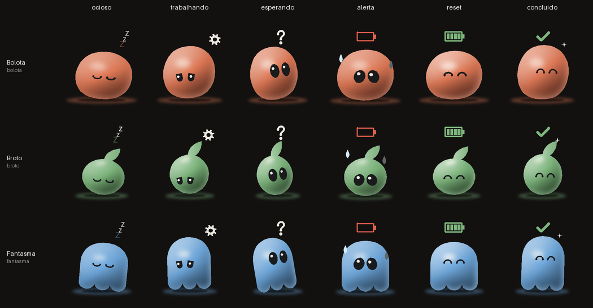

# O 3D opcional

Uma camada por cima das formas 2D de sempre: qualquer forma ganha volume, chão, giro e câmera sem modelagem e sem
dependência nova (só Pillow). É **2,5D**: a silhueta continua sendo o path do JSON; o que parece 3D é luz, sombra e
perspectiva calculadas a partir dela. **Desligado, nada muda**: sem `Estilo.volume` e sem um campo 3D na pose, o desenho
passa pelo caminho de sempre e sai igual pixel a pixel (os testes de referência conferem).

<p align="center">
  
</p>

## As quatro partes

| Parte | O que faz | Como liga |
| --- | --- | --- |
| **Volume** | O corpo parece inflado: um relevo macio tirado da silhueta, iluminado por uma luz (difuso, luz de contorno, um brilho, a parte de baixo mais escura); os olhos ganham um pontinho de luz | `Estilo(volume=Volume())`, `--volume` |
| **Profundidade** | Uma poça de luz no chão, na cor do corpo, com a sombra de contato por cima: ela encolhe e clareia quando o corpo sobe (`dy`) e acompanha a largura (`sx`, o giro). Extrusão opcional: uma face de trás mais escura | vem com o volume (`chao`, `sombra`, `espessura`) |
| **Giro** | `giroY` e `giroX` viram a forma: a silhueta estreita como um elipsoide visto de lado (até metade da largura, de perfil) e os olhos escorregam pela superfície; o de trás fica mais estreito e some na borda. De 90 a 270 graus são as costas, sem olhos: `giroY` de 0 a 360 é uma volta inteira | campos da animação |
| **Câmera** | `zoom` aproxima e `incl` tomba a tela inteira, em torno do meio do palco. Um extra com `"prof"` flutua na frente (> 0) ou atrás (< 0): anda mais ou menos que o corpo no giro e no zoom | campos da animação e `prof` nos extras |

O fundo é escuro, então uma sombra preta sozinha não apareceria: por isso o chão é uma poça de luz, e a sombra se lê
contra ela.

## Os campos novos (em `campos`, `trilhas` e `fases`, como os outros)

| Campo | Neutro | Faixa confortável | O que faz |
| --- | --- | --- | --- |
| `giroY` | 0 | ±35 para olhar; 0 a 360 para uma volta | vira para a direita (+) ou para a esquerda (−), em graus |
| `giroX` | 0 | ±35 | vira para baixo (+) ou para cima (−) |
| `zoom` | 1 | 0,75 a 1,35 | a câmera chega perto (> 1) ou se afasta |
| `incl` | 0 | ±20 | tomba a tela, em graus |
| `luzAng` | 0 | livre | gira a direção da luz no plano da tela, em graus (só com volume) |
| `luz` | 1 | 0 a 2 | multiplica a força da luz e do brilho (só com volume) |

São opcionais: só aparecem na pose de um estado que os usa, e a mistura entre estados parte do neutro. Nos extras com
lugar (`zzz`, `linhas`, `sinal`, `bateria`...), `"prof"` é a profundidade (0 = no plano do corpo).

## O objeto `Volume`

```python
estilo = oa.Estilo(volume=oa.Volume(luz_x=-0.55, luz_y=-0.8, forca=0.6))
img = oa.quadro(forma, "esperando", 0.4, estilo=estilo, biblioteca=oa.Biblioteca.carregar(pacote="3d"))
```

| Parâmetro | Padrão | O que é |
| --- | --- | --- |
| `luz_x`, `luz_y` | −0,55, −0,8 | de onde vem a luz (−1 = esquerda / de cima; 1 = direita / de baixo) |
| `frente` | 0,5 | 0 = luz rasante, de lado; 1 = de frente (menos sombra própria) |
| `forca` | 0,6 | o quanto o lado da luz clareia |
| `ambiente` | 0,5 | o quanto o lado escuro mantém da cor (1 = sem sombra própria) |
| `brilho`, `tamanho_brilho` | 0,55, 0,22 | a força e o tamanho do reflexo da luz |
| `contorno` | 0,35 | o filete de luz na borda do lado escuro |
| `embaixo` | 0,3 | o quanto a parte de baixo escurece |
| `arredonda` | 0,24 | o quanto o relevo é inflado (o raio do borrão, em relação ao corpo) |
| `chao`, `sombra` | 0,4, 0,65 | a poça de luz no chão e a sombra de contato |
| `espessura` | 0 | extrusão, em unidades do palco (0 = sem) |

O volume não depende do pacote: `--volume` (ou o `Estilo`) vale para o `classico` e o `vivo` também. O pacote `3d`
(`mascotinhos/animacoes_3d/`) são os seis estados do `vivo` com giro, câmera, luz e profundidade; na linha de comando
ele já liga o volume (`--chapado` desliga).

## Como é feito, e quanto custa

O relevo é a máscara da silhueta borrada (um borrão gaussiano largo): no miolo ela vale muito, na borda pouco, como
um corpo inflado. A luz é a diferença entre duas cópias desse relevo deslocadas na direção da luz; daí saem três
mapas (o quanto clareia, o quanto escurece, o brilho), guardados em cache por forma e por direção da luz (de 5 em 5
graus). A cada quadro os mapas são levados para a pose do corpo com uma transformação afim (esticar, girar, deslocar
e estreitar são todas afins) e colados só dentro da silhueta. Tudo em filtros e composições do Pillow, sem laço em
Python por pixel.

Medido num PC comum (Windows, Python 3.14, Pillow 12.2), na camada da telinha (156×170 desenhada em 2×):

| | média | pior quadro |
| --- | --- | --- |
| chapado (`classico`, `vivo`) | 0,2 a 1,1 ms | 3 ms |
| com volume (`vivo`, `3d`), contorno simples | 3,5 ms | 8 ms |
| com volume, forma de várias partes (regra nonzero) | 4,6 ms | 9 ms |

O orçamento da telinha é de 25 ms por quadro do mascote: sobra folga para uma máquina várias vezes mais lenta. O pior
quadro é o primeiro de uma direção de luz nova (o mapa entra no cache). `tests/test_3d.py` guarda esse limite.

## SVG: o que é aproximado

`quadro_svg` e `desenhar_svg` saem com a mesma pose (silhueta girada, olhos escorregados, extras com profundidade,
chão e sombra), e o volume vira gradientes recortados na silhueta, que um player em SVG/CSS reproduz sem filtro:

- a luz é **um gradiente linear** na direção dela, de um lado ao outro da caixa da forma, e não o relevo que segue o
  contorno: numa forma redonda fica muito parecido; numa de recortes (a nuvem, a folha do Broto) cada gomo não ganha a
  sua própria luz;
- a borda escurece com um gradiente radial, a parte de baixo com um linear e o brilho é uma elipse radial;
- **não tem** a luz de contorno nem a extrusão; o chão e a sombra são elipses com gradiente radial (sem borrão);
- as transparências se misturam no SVG, enquanto o Pillow substitui pixels: sobreposições de extras podem diferir.

## Limites

- É 2,5D. O giro estreita a silhueta e move os olhos; não mostra o lado da forma, e de perfil ela é só a silhueta
  estreita. As costas são a frente espelhada, sem olhos.
- A luz não projeta sombra de uma parte sobre outra (a folha do Broto não sombreia o corpo), e os extras não têm volume.
- A sombra no chão é uma elipse, não a projeção da silhueta.
- Malhas de verdade (um modelo 3D por mascote) seriam outro passo, só no app, com outro motor: não cabem numa
  biblioteca de Pillow nem num laço de 5 quadros por segundo.
- A 5 quadros por segundo, um giro de olhar deve durar 0,4 s ou mais; uma volta inteira, 1,2 s ou mais (seis quadros:
  frente, de lado, costas, de lado, frente).
