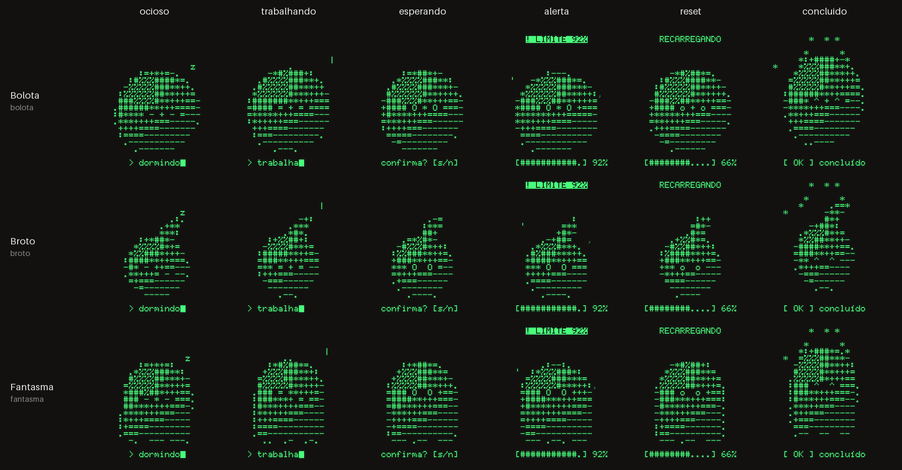

# O estilo terminal

Qualquer forma e qualquer animação, desenhadas em células de caracteres como num terminal antigo. É um **estilo de
desenho**, não só um pacote: a coreografia é a de sempre (esticar, inclinar, pular, girar); o que muda é que, a cada
quadro, a silhueta na pose é passada para uma grade fixa e escrita com letras. Quando o corpo se mexe, as células
acendem, apagam e trocam de letra.

<p align="center">
  
</p>

```python
estilo = oa.Estilo(terminal=oa.Terminal(tinta="ascii", fosforo="verde"))
img = oa.quadro(forma, "reset", 0.8, estilo=estilo, biblioteca=oa.Biblioteca.carregar(pacote="terminal"))
```

Na linha de comando: `--estilo terminal` (em qualquer pacote), `--tinta`, `--fosforo`; `--pacote terminal` já liga o
estilo. Sem `Estilo.terminal`, nada muda nos outros desenhos.

## A grade e a fonte

- A camada de 156x170 vira **26 colunas por 21 linhas** de células de 6x8 pontos (cada ponto, um pixel da tela; na
  camada em 2x, um bloco de 2x2). `Terminal(colunas=13)` dá letras com o dobro do tamanho.
- A fonte é uma monoespaçada de pontos desenhada para a biblioteca (`mascotinhos/fonte_bitmap.py`): o ASCII, as letras
  acentuadas do português, os blocos `█▓▒░▀▄`, as linhas de caixa `─│┌┐└┘` e o braille do spinner. Sem arquivo e sem
  dependência. `Terminal(fonte="arquivo.ttf")` (ou `--fonte`) troca por um TTF, recortado sem meio-tom.
- Não há antisserrilhado: cada ponto é aceso ou apagado. Ao reduzir a camada, use `Image.BOX` (a média exata de cada
  bloco) em vez de `LANCZOS`, para as células continuarem nítidas; a linha de comando já faz isso.

## As tintas

| `tinta` | Como o corpo é escrito |
| --- | --- |
| `ascii` | a rampa de densidade `.:-=+*#%@`: a luz do volume vira letras mais cheias de um lado e mais ralas do outro |
| `blocos` | `░▒▓█`, com a mesma luz |
| `contorno` | só a borda, com `/ \ \| - _`, escolhidos pela direção da borda em cada célula |

Os olhos viram letras conforme o estilo deles: `o o` (pílulas), `O O` (redondos, ou pílulas grandes), `^ ^` (felizes),
`- -` (fechados, ou piscando), `= =` (semicerrados); um de cada também vale (a espiada do sono). No corpo cheio, cada
olho fica num vão escuro, com uma célula vazia de cada lado.

## O acabamento

| Parâmetro de `Terminal` | Padrão | O que é |
| --- | --- | --- |
| `fosforo` | `"verde"` | a cor: `verde`, `ambar`, `branco`, `mascote` (a cor do corpo) ou `#RRGGBB` |
| `varredura` | 0,22 | as linhas de varredura: uma linha de pontos sim, outra não, fica mais escura |
| `halo` | 0,25 | o brilho em volta das letras acesas (0 = só os pontos) |
| `relevo` | `True` | a luz do volume nas tintas `ascii` e `blocos` (`False` = corpo de uma letra só) |
| `borda` | `True` | nas tintas `ascii` e `blocos`, a beirada do corpo leva as letras do contorno: a silhueta fica desenhada, e formas parecidas por dentro (um cubo, um escudo, um hexágono) continuam diferentes por fora |
| `colunas` | 26 | as colunas da grade |
| `dados` | `None` | os valores de quem desenha, para os textos (abaixo) |

## Os extras de terminal

Texto na grade, com o conteúdo no arquivo de animação. Aceitam `ancora`, `dx`, `dy` (como os outros extras com lugar;
`"rodape"` é a última linha da tela e `"cabecalho"` a primeira, e aí `dy` anda em linhas: 30 unidades ≈ uma linha) e
`alinha` (`centro`, `esq`, `dir`).

| Tipo | O que é | Parâmetros (padrão) |
| --- | --- | --- |
| `prompt` | uma linha sendo digitada, com o cursor de bloco piscando | `texto` ("> trabalhando"), `digita` (1,4 s; 0 = já escrita), `ciclo` (0 = digita uma vez), `cursor` (true), `pisca` (0,9 s) |
| `spinner` | o giratório de espera | `figura` (`barras` `\|/-\`, `braille`, `pontos`), `periodo` (0,9 s a volta) |
| `barra` | `[#####.....] 52%` | `modo` (`fixo`, `enchendo`, `esvaziando`), `valor` (50), `largura` (10), `ciclo`, `de`, `ate`, `cheio` ("#"), `vazio` ("."), `pct` (true), `treme` (false) |
| `rotulo` | um texto que aparece, pisca ou fica | `texto` ("[ OK ]"), `aparece`, `some`, `pisca` (0 = não pisca), `ciclo`, `inverso` (vídeo inverso), `segue_pulo` |

**Valores de verdade.** `{v}` no `texto` vira o `valor` do extra. Se o extra tem `"dado": "limite"` e quem desenha
passa `Terminal(dados={"limite": 87})`, vale o 87; sem isso, vale o `valor` do arquivo. É assim que o app passa a
porcentagem real para `! LIMITE {v}%` e para a barra do alerta. Os textos são conferidos ao ler a animação: até 40
letras, e só caracteres que a fonte tem.

Os extras desenhados dos outros pacotes têm um equivalente em caracteres (`zZ`, `...`, `?`, `'`, `*`, `[OK]`,
`[##..]`, o giratório no lugar da engrenagem), então `--estilo terminal` funciona com o `classico`, o `vivo` e o `3d`
(o giro e a câmera valem; o volume vira a luz das letras). E os extras de terminal, fora do estilo terminal, saem
como texto com a fonte do estilo.

## O pacote `terminal`

Os seis estados com a coreografia do `vivo` e a linguagem do terminal:

| Estado | O que aparece |
| --- | --- |
| `ocioso` | olhos `- -`, `zzZ` subindo, `> dormindo` com o cursor piscando devagar |
| `trabalhando` | olhos `= =` lendo, o giratório ao lado, `> trabalhando...` sendo digitado |
| `esperando` | olhos `O O`, um `?` piscando em vídeo inverso acima da cabeça, `confirma? [s/n]` com o cursor rápido |
| `alerta` | `! LIMITE 92%` piscando em vídeo inverso, a barra quase cheia tremendo, suor |
| `reset` | `RECARREGANDO` e a barra enchendo até 100%, depois `[ OK ]`, faíscas e um pulo com `^ ^` |
| `concluido` | o pulão com `^ ^` e estrelas, `[ OK ] concluído` digitado na última linha |

## Custo

Medido num PC comum, na camada da telinha: **5 ms** por quadro em `ascii` e `blocos` (a luz do relevo é a maior parte)
e **1,2 ms** em `contorno`, contra o orçamento de 25 ms. `tests/test_terminal.py` guarda o limite.

## O que é aproximado

- **A resolução é a da grade.** O corpo tem uns 16 por 12 caracteres: a silhueta se reconhece, os detalhes finos (o
  anel fino, um recorte pequeno) somem. Os olhos andam de célula em célula, não de pixel em pixel.
- **SVG.** `quadro_svg` sai com uma letra por `<text>`, cada uma na posição da sua célula, e os blocos e o vídeo
  inverso em `<rect>`: a grade é exata, mas a letra é a da fonte monoespaçada de quem abre o arquivo, não a de pontos;
  a varredura e o halo não vão. O `░▒▓` vira um retângulo com 25, 50 e 75% de opacidade.
- **A cor é uma só** (a do fósforo): destaque é vídeo inverso e piscar, como num terminal monocromático.
- O chão, a sombra e a extrusão do volume não aparecem neste estilo.
