# mascotinhos para o navegador

O player dos mascotinhos em JavaScript: lê **os mesmos JSON** de forma e de animação do pacote Python (`../mascotinhos/`)
e chega **às mesmas poses**, desenhadas num `<svg>` em linha. Assim o app e a telinha USB animam igual.

- **Sem dependências e sem build.** Módulos ES puros, com tipos escritos à mão (`index.d.ts`). Importa direto num app
  Vite/React/TypeScript, no navegador ou no Node.
- **Um laço só** de `requestAnimationFrame` para todos os mascotes da página. Quem está fora da tela
  (`IntersectionObserver`) ou numa aba escondida não desenha. Com o "reduzir movimento" do sistema, o mascote fica
  parado na pose do estado. `fps: 5` imita a telinha.
- **Conferido contra o Python**: as poses, cada chamada de desenho, o Animador, as mensagens de erro, o texto do SVG
  e, no **estilo terminal**, a mesma letra em cada célula da grade (ver [Paridade](#paridade)).

## Escolha o visual

O guia completo, com todas as opções e as imagens, está no [README principal](../README.md#escolha-o-visual). No
navegador, tudo entra nas opções de `montar(el, {...})` (e muda depois com `m.ajustar({...})`):

| Resultado | O que é | Como ligar |
| --- | --- | --- |
| 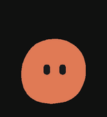 | **Pacote `classico`** (padrão): o movimento original | `montar(el, { forma: "bolota", estado: "reset" })` |
| 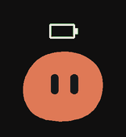 | **Pacote `vivo`**: mais expressivo | `{ pacote: "vivo" }` |
| 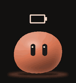 | **Pacote `3d`**: giro, câmera e luz (já com volume) | `{ pacote: "3d" }` |
| 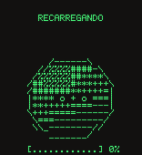 | **Pacote `terminal`**: prompt, barra, `[ OK ]` (já em letras) | `{ pacote: "terminal" }` |
| 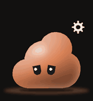 | **Volume**: luz, relevo, chão e sombra em qualquer pacote | `{ volume: true }` (`false` = chapado) |
| 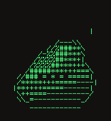 | **Estilo terminal** em qualquer pacote | `{ estilo: "terminal" }` (`"chapado"` volta) |
| 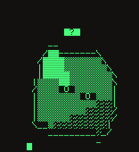 | **Tinta**: `ascii` (padrão), `blocos`, `contorno` | `{ tinta: "blocos" }` |
| 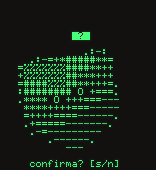 | **Borda** desenhada nas tintas cheias (vem ligada) | `{ borda: false }` |
| 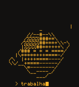 | **Fósforo**: `verde` (padrão), `ambar`, `branco`, `mascote`, `#RRGGBB` | `{ fosforo: "ambar" }` |
| 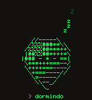 | **Varredura e halo** (vêm em 0,22 e 0,25) | `{ varredura: 0, halo: 0 }` |
| 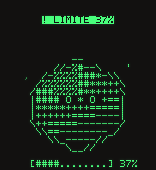 | **Números de verdade** nos textos do terminal | `{ dados: { limite: 37 } }` |
| 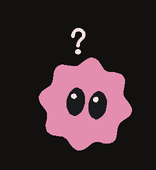 | **Quadros por segundo** (5 = como a telinha) | `{ fps: 5 }` |
| 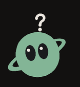 | **O mascote**: um dos doze ids (`bolota`, `broto`, `fantasma`, `ombro-cloud`, `sereno`, `orbita`, `cubo`, `scout`, `pixel`, `chevron`, `maestro`, `nova`) ou o JSON de uma forma | `{ forma: "orbita" }` |
| 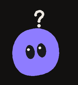 | **A cor** (sem `cor`, a sugerida do mascote; `#E07A57` para um JSON seu) | `{ cor: "#8E7CFF" }` |

## Criar um mascote

Uma **receita** do gerador vale no lugar da forma, e dá o mesmo mascote que o Python (guia com imagens no
[README principal](../README.md#crie-o-seu-mascote); cada parâmetro em [docs/gerador.md](../docs/gerador.md)):

```js
import { montar, gerar, receitaAleatoria, aleatorios, parametrosDa, corDaReceita } from "mascotinhos";

montar(el, { forma: { familia: "estrela", pontas: 6, semente: 7, cor: "#E58FB0" }, estado: "esperando", pacote: "vivo" });
const forma = gerar({ familia: "nuvem", gomos: 4 });   // o JSON do contrato v1, já conferido
const receita = receitaAleatoria(42);                  // a mesma para a mesma semente; aleatorios(12) dá doze diferentes
parametrosDa("estrela");                               // { pontas: { min: 4, max: 8, padrao: 5, inteiro: true }, ... }
```

Na demonstração, o painel **Criar mascote** faz isso com controles: família, um controle por parâmetro, semente, cor,
o mascote ao vivo no estilo escolhido na página e o botão **copiar JSON** (a receita ou a forma pronta).

## O que tem aqui

| Arquivo | O que é |
| --- | --- |
| `index.js`, `index.d.ts` | A entrada do pacote e os tipos |
| `src/movimento.js` | As primitivas (onda, quique, arco, rampa, mola, treme, soma, produto), porte de `movimento.py` |
| `src/animacao.js` | Lê e confere as animações; fases, ciclos, olhos por fase; a `Biblioteca` e os pacotes (`animacao.py`) |
| `src/formas.js` | O path SVG vira polígonos (M L H V C S Q T A Z, regra nonzero); `lerDefinicao`, `validarDefinicao` (`formas.py`) |
| `src/palco.js`, `src/extras.js` | O palco e os 19 extras, os 4 de texto do terminal inclusive (`palco.py`, `extras.py`) |
| `src/terminal.js` | O estilo terminal: a grade de caracteres, as tintas, os olhos e os extras em letras, e a grade em SVG (`terminal.py`) |
| `src/raster.js` | O pedaço do Pillow que o terminal usa (polígono, elipse, borrão gaussiano, bicúbico, afim bilinear, colar com máscara, reduce), com as mesmas contas inteiras |
| `src/fonte.js` | A fonte de pontos 6x8 do terminal (a de `fonte_bitmap.py`) |
| `src/volume.js` | O 3D: giro, câmera, profundidade dos extras, a luz e as cores do volume (`volume.py`) |
| `src/desenho.js` | Corpo, olhos (os cinco estilos) e extras numa pose, chapado ou 3D (`desenho.py`) |
| `src/svg.js` | O pintor SVG e o `quadroSvg` (`svg.py`) |
| `src/gerador.js` | O gerador de mascotes: da receita (família, parâmetros, semente) à forma, com as mesmas contas do `gerador.py` |
| `src/animador.js` | O `Animador`: mistura de estados, troca de forma, realce da cor (`animador.py`) |
| `src/runtime.js` | `montar`: o mascote vivo na página |
| `dados/` | **Gerado**: cópia dos pacotes `classico`, `vivo`, `3d`, `terminal`, das formas de exemplo e da fonte de pontos (`fonte_bitmap.json`), e `embutidos.js` com tudo isso como módulo |
| `scripts/sincronizar.mjs` | Copia os JSON do pacote Python para `dados/` e pede ao Python a tabela da fonte (`--conferir` só confere) |
| `scripts/referencia.py` | Gera `tests/referencia.json` com o próprio pacote Python |
| `scripts/referencia_gerador.py` | Gera `tests/referencia_gerador.json`: o que o gerador do Python devolve para mais de quatrocentas receitas |
| `scripts/previas.py` | A folha do Python e a do JavaScript lado a lado, retratadas no Chrome sem janela |
| `tests/` | `node --test`: paridade, SVG, runtime (com um DOM falso), sincronia e o gerador (a mesma receita, a mesma forma do Python) |
| `demo/` | `index.html` (o painel Criar mascote, a galeria, o palco, colar JSON) e `folha.html` (a folha do Python, desenhada aqui) |

O Python continua sendo a fonte única dos JSON e da fonte: mudou uma animação em `mascotinhos/animacoes*/` ou um
desenho em `fonte_bitmap.py`? Rode `node scripts/sincronizar.mjs` (o teste `sincronia` falha até isso).

## Usar

Enquanto não está no npm, copie a pasta `js/` para o projeto (por exemplo `vendor/mascotinhos/`) e aponte para ela:
`"mascotinhos": "file:vendor/mascotinhos"` no `package.json`. Depois, `import { montar } from "mascotinhos"`.

```js
import { montar, quadroSvg } from "mascotinhos";

const m = montar(document.querySelector("#mascote"), {
  forma: "bolota",        // id de exemplo, o JSON da forma (contrato v1) ou uma Definicao
  estado: "esperando",
  pacote: "vivo",         // "classico" (padrão, o da telinha), "vivo", "3d" ou "terminal"
  cor: "#E07A57",
  tamanho: 156,           // largura em px CSS; sem ele, ocupa o elemento
});
m.irPara("trabalhando");                // mistura com o anterior por 0,5 s
m.usarForma(minhaForma, "#6FA8DC");     // encolhe, pisca e troca no meio (0,6 s)
m.ajustar({ volume: true, fps: 5 });    // também: cor, pacote, extras, enquadre, tamanho, paleta
m.pausar(); m.retomar(); m.destruir();

const svg = quadroSvg("bolota", "esperando", 0.4);   // texto; funciona no Node (testes, SSR)
```

### `montar(elemento, opcoes)`

| Opção | Padrão | O que faz |
| --- | --- | --- |
| `forma` | `"bolota"` | id de exemplo, JSON (contrato v1), `Definicao`, `Forma` ou uma receita do gerador (`{ familia: "estrela", pontas: 6 }`) |
| `estado` | `"ocioso"` | o estado inicial |
| `animacao` | | uma animação de fora (JSON): entra na biblioteca e vira o estado inicial |
| `pacote` / `biblioteca` | `"classico"` | os estados embutidos, ou uma `Biblioteca` pronta |
| `cor` | a do mascote | a cor do corpo; sem ela, a sugerida da forma que vem junto ou a da receita (e acompanha o `usarForma`); para um JSON seu, `"#E07A57"` |
| `volume` | só no pacote `3d` | luz, relevo, chão e sombra (em gradientes) |
| `tamanho` | | largura em px CSS (a altura segue a proporção); sem ele, `width/height="100%"` |
| `fps` | do navegador | limite de quadros por segundo (5 = como a telinha) |
| `extras` | `true` | `false` tira o zZ, o "?", a bateria... |
| `enquadre` | `"palco"` | `"corpo"`: a viewBox fica justa no corpo e os extras vazam (bom para avatares pequenos) |
| `rotulo` | | `aria-label`; sem ele, o `<svg>` fica `aria-hidden` |
| `reduzirMovimento` | o do sistema | `true` força a pose parada, `false` força animar |
| `tEstatico` | `1.2` | o instante da pose parada (o mesmo da folha do Python) |
| `estilo` | `"chapado"` (`"terminal"` no pacote terminal) | `"terminal"`: tudo em células de caracteres (abaixo) |
| `tinta`, `fosforo` | `"ascii"`, `"verde"` | no terminal: `ascii`, `blocos` ou `contorno`; `verde`, `ambar`, `branco`, `mascote` ou `#RRGGBB` |
| `dados` | | no terminal: os valores dos textos com `"dado"`, como `{limite: 87}` |
| `colunas`, `relevo`, `borda`, `varredura`, `halo` | `26`, `true`, `true`, `0.22`, `0.25` | o resto do `Terminal` do Python |

O controle devolvido tem `irPara(estado | jsonDeAnimacao)`, `usarForma(forma, cor?, {ja})`, `ajustar(opcoes)`,
`pausar()`, `retomar()`, `destruir()`, `relogio()`, e `svg`, `animador`, `estado`, `estilo`, `pausado`.

### O estilo terminal

```js
const m = montar(el, { forma: "bolota", estado: "alerta", pacote: "terminal", fosforo: "ambar", dados: { limite: 92 } });
m.ajustar({ dados: { limite: 87 } });   // "! LIMITE 87%" e a barra em 87%, no próximo quadro
m.ajustar({ estilo: "terminal", tinta: "blocos" });   // vale em qualquer pacote; { estilo: "chapado" } volta
quadroSvg("broto", "reset", 1.0, { pacote: "terminal", tinta: "contorno" });
```

A grade é a do Python célula a célula: a silhueta na pose é rasterizada, a luz do relevo calculada e cada célula
reduzida com as mesmas operações do Pillow, portadas em `src/raster.js` e conferidas uma a uma contra o Pillow
(polígono e elipse pixel a pixel, borrão gaussiano de três caixas, bicúbico, afim bilinear, colar com máscara,
`convert("L")`, `reduce`). As letras saem da fonte de pontos da biblioteca, cada ponto um retângulo
(`shape-rendering="crispEdges"`): nítido em qualquer tamanho. Custa ~1,2 ms por quadro em `ascii`/`blocos` e
~0,3 ms em `contorno`, no Node, num PC comum.

### Mais baixo nível

`quadroSvg(forma, estado, t, opcoes)` dá o quadro de um instante como texto. Sem opções, é **o mesmo texto** do
`quadro_svg` do Python. Opções: `cor`, `pacote`, `volume`, `enquadramento`, `paleta`, `prefixo` (dos ids de
gradiente, para vários SVG na mesma página), `enquadre`, `extras`. Também estão exportados: `Animador` (tempos em
segundos), `Biblioteca` (`Biblioteca.carregar({pacote, animacoes})`), `lerDefinicao`/`validarDefinicao`,
`lerAnimacao`/`validarAnimacao` (devolvem `{erros, avisos}` com as mensagens do Python), `poligonos`, `formaDe`,
`pintar` (com qualquer pintor), `exemplos()`, `pacotes()`, `tipoDeArquivo(json)`.

## Exemplo em React

```tsx
import { useEffect, useRef } from "react";
import { montar, type DadosForma, type Mascotinho as Controle } from "mascotinhos";

type Props = { forma: DadosForma; estado?: string; cor: string; pacote?: string; tamanho?: number; fps?: number; rotulo?: string };

export function Mascotinho({ forma, estado = "ocioso", cor, pacote = "classico", tamanho = 64, fps, rotulo }: Props) {
  const caixa = useRef<HTMLDivElement>(null);
  const m = useRef<Controle | null>(null);
  useEffect(() => {
    m.current = montar(caixa.current!, { forma, estado, cor, pacote, tamanho, fps, rotulo, enquadre: "corpo" });
    return () => m.current?.destruir();
    // monta uma vez por pacote; o resto muda pelos efeitos abaixo, sem remontar
    // eslint-disable-next-line react-hooks/exhaustive-deps
  }, [pacote]);
  useEffect(() => m.current?.irPara(estado), [estado]);
  useEffect(() => m.current?.usarForma(forma, cor), [forma, cor]);
  useEffect(() => m.current?.ajustar({ tamanho, fps }), [tamanho, fps]);
  return <div ref={caixa} style={{ width: tamanho, height: tamanho }} />;
}
```

Pedir o mesmo estado ou a mesma forma e cor de novo não faz nada (como no Python), então os efeitos podem rodar à
vontade, inclusive no `StrictMode`.

## Como o app do Ombro trocaria o renderizador

Isto é um roteiro, não algo já feito: hoje o app do Ombro desenha com o `open-bot-avatar` e põe os extras por CSS. Os
passos, sem mexer em nada fora de `app/`:

1. **Dependência** (`package.json`): trocar `"open-bot-avatar": "0.2.1"` por `"mascotinhos"` (a pasta `js/`
   copiada em `vendor/mascotinhos` com `"file:vendor/mascotinhos"`, ou uma versão do npm fixada).
2. **`src/features/avatars/catalog.ts`**: `validateAvatar(defs[id])` vira `validarDefinicao(defs[id], id)` (`erros`
   vazio = ok; os nove avatares de `avatars/defs/` passam sem erro nem aviso) e `lerDefinicao` para o valor;
   `AvatarDefinition` vira `DadosForma`. `moodFor` e o tipo `AvatarMotion` saem: o motor toca direto os seis estados
   de `state.ts` (`ocioso`, `trabalhando`, `esperando`, `alerta`, `reset`, `concluido`, os mesmos nomes).
3. **`src/features/avatars/AvatarView.tsx`**: `LiveAvatar` usa `montar(host, {forma, estado, cor, pacote,
   enquadre: "corpo"})`, com `irPara`/`usarForma` no efeito de atualização (o componente acima). `StillAvatar` usa
   `quadroSvg(definition, state ?? "ocioso", 1.2, {cor, pacote, enquadre: "corpo", extras: Boolean(state), prefixo})`
   no mesmo `dangerouslySetInnerHTML` de hoje (o texto vem de números e cores conferidos). `AvatarExtra` sai inteiro:
   o "?", a gota, o ✓, os pontinhos, o confete e o z passam a ser os mesmos da telinha, desenhados pelo motor. O
   `follow` (olhos seguindo o ponteiro) não tem equivalente: sai ou fica para depois. O caso "sem canvas" some (é
   SVG puro; sem `requestAnimationFrame`, desenha uma vez).
4. **`src/features/avatars/ProviderAvatar.tsx`**: `mood={moodFor(...)}` vira `estado={acompanha ? estado :
   "ocioso"}`; no `SessionAvatar`, `estado={sessionState(status)}`. `state.ts` e `useMascotState.ts` não mudam.
5. **`src/features/avatars/AvatarSettings.tsx`**: o seletor `MOODS` (idle/thinking/happy) passa a listar os estados
   (`bibliotecaDoPacote(pacote).estados()`), e o import de `AvatarMotion` sai.
6. **`src/features/avatars/catalog.test.ts`**: `renderAvatarSvg` vira `quadroSvg`; "aprovados pelo validador do
   open-bot-avatar" vira `validarDefinicao`.
7. **`src/styles/pages.css`**: as regras `.avatar-extra`, `.extra-*` e as `@keyframes extra-*` podem sair (a regra
   `.avatar svg { overflow: visible }` continua útil com `enquadre: "corpo"`).

Para o app e a telinha baterem: o mesmo `pacote` dos dois lados (a telinha usa o `classico`), e `fps: 5` se quiser o
mesmo passo da tela. No estilo terminal, o app passa a porcentagem real do limite em `dados` (por exemplo,
`ajustar({dados: {limite}})` quando chega um retrato novo do ombrod), como a telinha passa em `Terminal(dados=...)`.

## Paridade

`scripts/referencia.py` roda o pacote Python e grava `tests/referencia.json`, que `tests/paridade.test.mjs` confere:

| O quê | Quanto | Maior erro do JS |
| --- | --- | --- |
| Poses (`parametros(t)` e o estilo dos olhos), 4 pacotes × 6 estados × 81 instantes | 1944 poses, 20 896 números | 7e-15 |
| Cada chamada de desenho (corpo, olhos, extras, chão, volume), 4 pacotes × 3 formas × 6 estados, chapado e com volume | 810 quadros, 78 033 números | 2e-12 px |
| O Animador quadro a quadro (mistura, troca de forma no meio da troca, realce da cor) | 112 quadros | 4e-12 px |
| Terminal: a grade de cada quadro (a letra, a força e o vídeo inverso de cada célula), as 3 tintas, 4 pacotes, `dados`, 13 colunas, sem relevo, sem borda | 618 grades, 72 073 células | todas iguais |
| Formas no palco e 18 paths com todos os comandos (e os erros de path) | 21 casos | 0 |
| Mensagens de erro e avisos de `validar_definicao` e `validar_animacao` (os textos do terminal inclusive) | 79 entradas ruins | iguais |
| Texto do `quadro_svg` (chapado e com volume) | 7 documentos | iguais, caractere a caractere |

Os pontos dos polígonos vão como impressão digital (quantos, o primeiro, o último, a soma e a soma ponderada pela
posição), e os números com 7 casas, para o arquivo ficar em ~1,5 MB: por isso o teste mostra "maior erro 5e-8" (o
arredondamento). O erro real acima foi medido com `python scripts/referencia.py OUTRO.json --casas 17` e
`MASCOTINHOS_REFERENCIA=OUTRO.json`. A tolerância do teste é 1e-6. Os nove avatares do app (`codigo/avatars/defs/`)
também saem com o SVG idêntico ao do Python (648 quadros conferidos à mão, fora do arquivo de referência).

```bash
cd js
node --test "tests/*.test.mjs"        # Node 22 ou mais novo (o glob do --test)
node scripts/sincronizar.mjs --conferir
python scripts/referencia.py          # depois de mudar o desenho no Python, de propósito
```

## O que é aproximado em relação ao Python (Pillow)

A geometria é a mesma (corpo, olhos, extras, giro, câmera, chão). O que muda é como os pixels saem:

- **Volume**: como o `svg.py`, vira gradientes recortados na silhueta (a luz é um gradiente linear na direção dela, a
  borda escurece com um radial, a parte de baixo com um linear, o brilho é uma elipse radial). Não tem o relevo que
  segue o contorno nem a luz de contorno do Pillow: numa forma redonda fica parecido; em gomos (a folha do Broto) cada
  parte não ganha a sua própria luz.
- **Chão e sombra**: elipses com gradiente radial, desenhadas maiores (rx × 1,45, ry × 1,9) que a poça borrada do
  Pillow para imitar o borrão. No SVG o brilho do chão fica mais largo (ver `comparacao_3d_volume.png`).
- **Transparências**: o SVG mistura; o Pillow substitui o pixel. Onde um extra translúcido passa por cima do corpo (o
  confete do `reset`, a gota do `alerta`), a cor difere.
- **Texto** (zZ): `JetBrains Mono, ui-monospace, Menlo, monospace` em negrito. O player não traz a fonte: sem a
  JetBrains Mono instalada ou carregada pela página (um `@font-face` de quem usa), sai a fonte monoespaçada do
  sistema. No Python, o texto sai com a fonte padrão do Pillow, ou com a JetBrains Mono Bold que vem no pacote Python
  quando se pede (`fonte_jetbrains_mono()`). A posição é a mesma; o desenho da letra pode não ser.
- **Antisserrilhado** e o redimensionamento LANCZOS da telinha não existem aqui: o SVG é nítido em qualquer tamanho.
- **Terminal**: as letras e as células são as mesmas; o acabamento é aproximado. As linhas de varredura são uma
  máscara SVG (a mesma geometria: uma linha de pontos sim, outra não, `1 - varredura` mais fraca). O halo é um
  filtro SVG (borrão de `ponto × 1,1` vezes `halo`, por baixo das letras), no lugar do máximo entre a tinta e o
  borrão do Pillow, e pode clarear um pouco o furo das letras em vídeo inverso. A opção `fonte` (TTF) do `Terminal`
  do Python não existe aqui. O `quadro_svg` do Python, no terminal, escreve `<text>` com uma fonte do sistema; o
  daqui desenha a fonte de pontos, então os dois textos SVG não se comparam (a grade sim).

## Ver

- `node --test "tests/*.test.mjs"` (os testes);
- a demonstração: na raiz do repositório, `python -m http.server 8000 --bind 127.0.0.1` e abra
  `http://127.0.0.1:8000/js/demo/` (módulos ES não carregam de `file://`). `demo/folha.html?pacote=vivo&escala=2` é a
  folha do Python desenhada aqui;
- `python js/scripts/previas.py --saida PASTA`: a folha do Python e a do JavaScript lado a lado (classico, vivo, 3d
  com volume, terminal em ascii verde e em blocos âmbar) e retratos da demonstração, com o Chrome sem janela e um
  servidor temporário em 127.0.0.1. A demonstração tem o estilo terminal, a tinta, o fósforo e o "limite" ao vivo.

## Falta

- Olhos que seguem o ponteiro (o `follow` do app de hoje).
- A fonte TTF no terminal (`Terminal.fonte` do Python).
